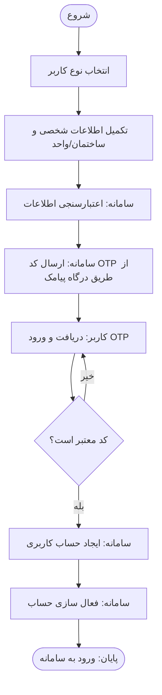
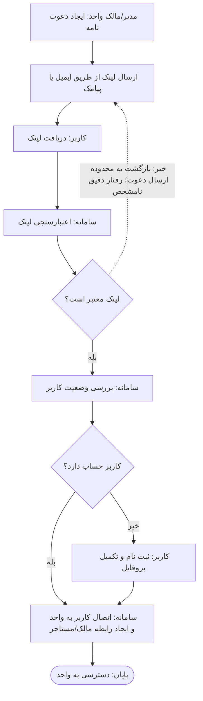
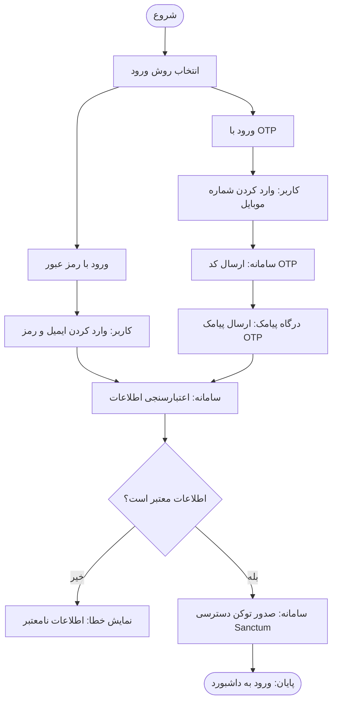
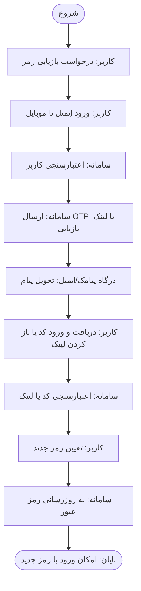
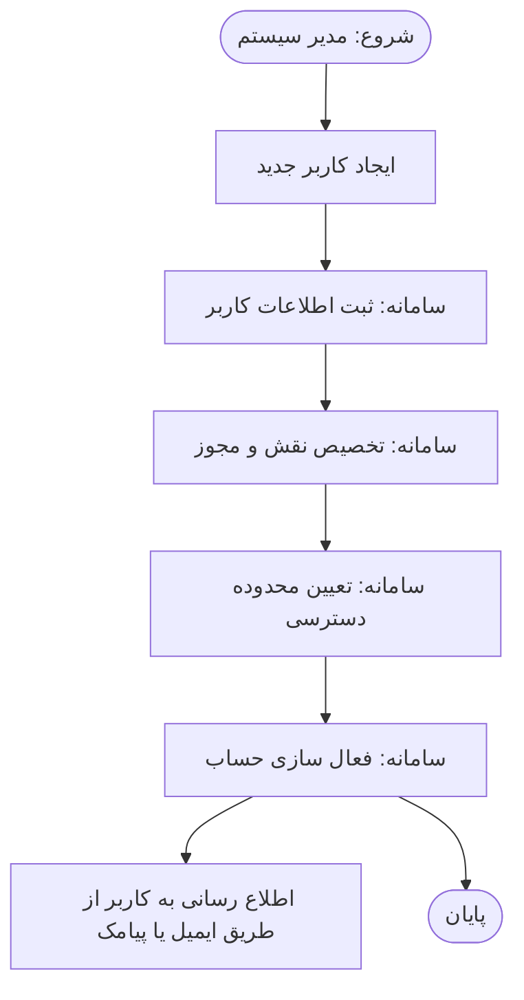
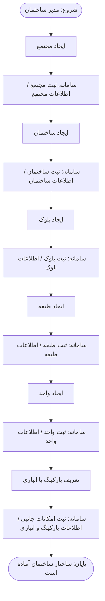

# مشخصات قابل‌فهم برای Codex از نمودار فرآیندهای اصلی Buildino

> **نوع سند:** استخراج و ساختاردهی فرآیندهای کسب‌وکار (Business Process Specification) از یک تصویر؛ نه طراحی نهایی Frontend و نه تعریف قرارداد Backend.
>
> **مرجع:** تصویر «نمودار جریان فرآیندهای اصلی سامانه Buildino»، با برچسب نسخهٔ **۲.۱.۱** و عبارت «بر اساس آخرین نسخه مخزن Git» در خود تصویر.
>
> **تاریخ استخراج:** ۲۰۲۶-۱۰-۱۴
>
> **پوشش قطعی:** فقط شش نمودار P01 تا P06 که واقعاً در تصویر دیده می‌شوند.
>
> **هدف مرحلهٔ فعلی:** Codex بتواند منطق، کنشگران، شرایط و خروجی هر فرآیند را بفهمد تا **در مرحلهٔ بعد** بتوان صفحات، حالت‌ها و مسیرهای کاربری Frontend را با اتکا به این سند و کد واقعی پروژه استخراج کرد. **در این مرحله پیاده‌سازی UI، ایجاد API یا تغییر کد درخواست نشده است.**

---

## ۰. قرارداد خواندن و درجهٔ اطمینان

در این سند، اطلاعات با سه برچسب متمایز می‌شوند:

- **[تصویر]**: متن یا رابطه‌ای که مستقیماً در نمودار وجود دارد.
- **[برداشت منطقی]**: نتیجهٔ عملی و معقول برای فهم جریان؛ الزام قطعی محصول نیست و ممکن است تأیید بخواهد.
- **[نامشخص/نیازمند تأیید]**: جزئیات غایب، دوپهلو یا متناقض در تصویر. Codex نباید دربارهٔ این موارد تصمیم قطعی بگیرد.

### ۰.۱. معنی نمادهای نمودار [تصویر]

| شکل/رنگ | معنی در این سند |
|---|---|
| بیضی سبز | شروع یا پایان فرآیند |
| مستطیل آبی | اقدام یک کنشگر یا پردازش سامانه |
| لوزی | پرسش تصمیم‌گیری و انشعاب |
| مسیر سبز «بله» | شاخهٔ تأییدشده/مثبت تصمیم |
| مسیر قرمز «خیر» | شاخهٔ ردشده/منفی تصمیم |
| مستطیل بنفش | اقدام درگاه خارجی، کنشگر دعوت‌کننده یا اطلاعات ذخیره‌شده؛ معنای دقیق آن تابع عنوان ستون است |
| ستون‌های عمودی | Swimlane: مسئول هر اقدام را از روی عنوان ستون تعیین می‌کنند |

**نکته:** رنگ به‌تنهایی مدل وضعیت، API یا طراحی کامپوننت Frontend را تعیین نمی‌کند.

### ۰.۲. مرز پوشش [تصویر]

زیرعنوان کلی تصویر به «ثبت‌نام، مدیریت ساختمان، پرداخت‌ها، خدمات و گزارش‌ها» اشاره می‌کند؛ بااین‌حال **تنها P01 تا P06 جزئیات اجرایی دارند**. از این مرجع نمی‌توان فرآیند پرداخت، خدمات، تیکت، گزارش‌گیری و سایر امکانات را استخراج یا اختراع کرد.

---

## ۱. فهرست فرآیندها و خروجی‌ها

| شناسه | عنوان دقیق/نزدیک به تصویر | کنشگر اصلی | نتیجهٔ موفق |
|---|---|---|---|
| P01 | فرآیند ثبت‌نام و ایجاد حساب کاربری | کاربر | حساب ساخته و فعال شده؛ امکان ورود به سامانه |
| P02 | فرآیند پذیرش دعوت‌نامه واحد | مدیر/مالک واحد، کاربر دعوت‌شده | رابطهٔ مالک/مستأجر با واحد ایجاد شده؛ دسترسی به واحد |
| P03 | فرآیند ورود به سامانه | کاربر | صدور توکن دسترسی با برچسب Sanctum؛ ورود به داشبورد |
| P04 | فرآیند بازیابی رمز عبور | کاربر | رمز عبور به‌روزرسانی شده؛ امکان ورود با رمز جدید |
| P05 | فرآیند مدیریت کاربران و دسترسی‌ها | مدیر سیستم | کاربر ایجاد، نقش/مجوز/محدوده تعیین و حساب فعال شده |
| P06 | فرآیند ایجاد و پیکربندی ساختار ساختمان | مدیر ساختمان | ساختار مجتمع/ساختمان/بلوک/طبقه/واحد و امکانات جانبی ثبت شده |

### ۱.۱. واژه‌نامهٔ کنشگران

| عنوان نمودار | وظیفهٔ نشان‌داده‌شده |
|---|---|
| کاربر | انتخاب و تکمیل داده‌ها، دریافت و ورود OTP، ورود به سامانه، دریافت دعوت‌نامه یا درخواست بازیابی |
| سامانه | اعتبارسنجی، ثبت و فعال‌سازی، مدیریت دسترسی، ایجاد پیوند کاربر و واحد، صدور توکن |
| درگاه پیامک | ارسال SMS حاوی OTP |
| درگاه پیامک/ایمیل | ارسال OTP یا لینک بازیابی از طریق کانال مربوط |
| مدیر/مالک واحد | ایجاد و ارسال دعوت‌نامهٔ واحد |
| مدیر سیستم | شروع جریان ساخت کاربر توسط مدیریت |
| مدیر ساختمان | ایجاد ساختار املاک/ساختمان |
| اطلاعات ذخیره‌شده | مقصد داده‌های ثبت‌شده در P06؛ کنشگر انسانی نیست |

**تمایز مهم:** «نوع کاربر در P01»، «نقش در P05»، «محدودهٔ دسترسی» و «رابطهٔ کاربر با واحد در P02» در نمودار مفاهیم جداگانه هستند؛ برابر دانستن خودکار آن‌ها **مجاز نیست**.

---

# ۲. P01 — ثبت‌نام و ایجاد حساب کاربری

## ۲.۱. تعریف و هدف [تصویر]

- **عنوان:** فرآیند ثبت‌نام و ایجاد حساب کاربری
- **توضیح زیر عنوان:** ثبت‌نام کاربران «مالک، مستأجر، مدیر، ارائه‌دهندهٔ خدمت و ...»
- **Swimlaneها:** کاربر، سامانه، درگاه پیامک
- **نقطهٔ ورود:** شروع ثبت‌نام
- **شرط موفقیت:** کد OTP معتبر باشد؛ حساب ایجاد و سپس فعال شود.
- **نتیجه:** «پایان (ورود به سامانه)»

## ۲.۲. مراحل و مسئولیت‌ها [تصویر]

| ID | مسئول | اقدام | ادامه |
|---|---|---|---|
| P01-S01 | کاربر | شروع | P01-S02 |
| P01-S02 | کاربر | انتخاب نوع کاربر | P01-S03 |
| P01-S03 | کاربر | تکمیل اطلاعات ثبت‌نام: «شخصی و ساختمان/واحد» | P01-S04 |
| P01-S04 | سامانه | اعتبارسنجی اطلاعات | P01-S05 |
| P01-S05 | سامانه | ارسال کد OTP | P01-S06/P01-S07 |
| P01-S06 | درگاه پیامک | ارسال پیامک OTP | تحویل کد به کاربر در همین مرحلهٔ تأیید |
| P01-S07 | کاربر | دریافت و وارد کردن کد OTP | P01-D01 |
| P01-D01 | تصمیم | «کد معتبر است؟» | بله: P01-S08؛ خیر: بازگشت به P01-S07 |
| P01-S08 | سامانه | ایجاد حساب کاربری | P01-S09 |
| P01-S09 | سامانه | فعال‌سازی حساب | P01-END |
| P01-END | پایان | ورود به سامانه | — |

**دقت دربارهٔ فلش‌ها:** چیدمان بصری اتصال به درگاه پیامک در تصویر معادل یک قرارداد فنیِ درخواست/پاسخ نیست. تفسیر عملی این است که سامانه از درگاه برای تحویل OTP استفاده می‌کند؛ ترتیب فنی دقیق ارتباط با سرویس پیامک از تصویر قابل‌استنتاج نیست.

## ۲.۳. شرط تصمیم [تصویر]

| شرط | نتیجه |
|---|---|
| OTP معتبر است | ایجاد حساب → فعال‌سازی حساب → ورود به سامانه |
| OTP معتبر نیست | بازگشت به مرحلهٔ دریافت/ورود کد OTP؛ تصویر ارسال خودکار کد جدید را نشان نمی‌دهد |

## ۲.۴. داده‌ها و خروجی‌ها

- **[تصویر] داده‌های مورد درخواست:** نوع کاربر؛ اطلاعات شخصی؛ اطلاعات ساختمان/واحد؛ کد OTP.
- **[تصویر] عملیات سامانه:** اعتبارسنجی ثبت‌نام، OTP، ساخت حساب، فعال‌سازی.
- **[نامشخص]** فیلدهای دقیق اطلاعات شخصی و ساختمان/واحد، الزامی‌بودن هر فیلد، روش نگهداری رمز عبور، شمارهٔ همراه مقصد، قواعد تکراری‌بودن حساب و اینکه نوع کاربر چه مقادیری دارد.
- **[نامشخص]** آیا ثبت‌نام در این مسیر، رکورد ساختمان/واحد می‌سازد یا فقط اطلاعات/وابستگی موجود را درخواست می‌کند؟ این موضوع با P06 قابل جایگزینی نیست.

## ۲.۵. نمایش ساختاری جریان



---

# ۳. P02 — پذیرش دعوت‌نامه و اتصال به واحد

## ۳.۱. تعریف و هدف [تصویر]

- **عنوان:** فرآیند پذیرش دعوت‌نامه واحد
- **توضیح:** اتصال کاربر به واحد از طریق لینک دعوت‌نامه
- **Swimlaneها:** کاربر، سامانه، مدیر/مالک واحد
- **نقطهٔ شروع از نگاه کاربر:** دریافت لینک دعوت‌نامه
- **پیش‌زمینهٔ نمایش‌داده‌شده:** مدیر/مالک واحد دعوت‌نامه را ایجاد و از طریق «ایمیل/پیامک» ارسال می‌کند.
- **نتیجه:** «پایان (دسترسی به واحد)»

## ۳.۲. مراحل و مسئولیت‌ها [تصویر]

| ID | مسئول | اقدام | ادامه |
|---|---|---|---|
| P02-S01 | مدیر/مالک واحد | ایجاد دعوت‌نامه برای واحد | P02-S02 |
| P02-S02 | مدیر/مالک واحد | ارسال لینک دعوت‌نامه (ایمیل/پیامک) | P02-S03 |
| P02-S03 | کاربر | دریافت لینک دعوت‌نامه | P02-S04 |
| P02-S04 | سامانه | اعتبارسنجی لینک | P02-D01 |
| P02-D01 | تصمیم | «لینک معتبر است؟» | بله: P02-S05؛ خیر: مسیر قرمز به سمت بخش ارسال لینک دعوت در ستون دعوت‌کننده |
| P02-S05 | سامانه | بررسی وضعیت کاربر | P02-D02 |
| P02-D02 | تصمیم | «کاربر حساب دارد؟» | بله: P02-S07؛ خیر: P02-S06 |
| P02-S06 | کاربر | ثبت‌نام و تکمیل پروفایل | P02-S07 |
| P02-S07 | سامانه | اتصال کاربر به واحد (ایجاد رابطهٔ مالک/مستأجر) | P02-END |
| P02-END | پایان | دسترسی به واحد | — |

## ۳.۳. شرط‌های تصمیم [تصویر]

| شرط | نتیجه |
|---|---|
| لینک معتبر است | وضعیت داشتن/نداشتن حساب بررسی می‌شود |
| لینک نامعتبر است | مسیر قرمز به ناحیهٔ «ارسال لینک دعوت» برمی‌گردد؛ **معلوم نیست** خطا نمایش داده می‌شود، دعوت‌کننده باید لینک تازه بسازد یا ارسال مجدد خودکار است. |
| کاربر حساب دارد | مستقیماً وارد مرحلهٔ اتصال کاربر به واحد می‌شود |
| کاربر حساب ندارد | ثبت‌نام و تکمیل پروفایل → اتصال به واحد |

## ۳.۴. داده‌ها، وضعیت‌ها و مرزها

- **[تصویر]** دعوت‌نامه برای **یک واحد** ایجاد می‌شود؛ لینک از طریق ایمیل یا پیامک فرستاده می‌شود.
- **[تصویر]** ارتباط حاصل با واحد به شکل «رابطهٔ مالک/مستأجر» توصیف شده است.
- **[برداشت منطقی]** اطلاعات مفهومی مورد نیاز برای فهم جریان: لینک دعوت، واحد هدف، کاربر دعوت‌شده، وضعیت معتبر/نامعتبر لینک و رابطهٔ کاربر با واحد.
- **[نامشخص]** ساختار توکن دعوت‌نامه، تاریخ انقضا، یک‌بارمصرف‌بودن، تعداد دعوت‌های هم‌زمان، نحوهٔ تشخیص هویت گیرنده، مجوز دعوت‌کننده و اینکه عضویت نیاز به تأیید مجدد دارد یا خیر.
- **[نامشخص]** «ثبت‌نام و تکمیل پروفایل» دقیقاً کل P01 را اجرا می‌کند یا یک جریان کوتاه‌تر دارد؟ ارتباط با P01 محتمل است ولی در تصویر ترسیم نشده.
- **[نامشخص]** وضعیت‌های دیگر نسبت با واحد (مثلاً ساکن غیرمستأجر) در این فرآیند نیامده‌اند؛ نباید اضافه شوند.

## ۳.۵. نمایش ساختاری جریان



> فلش نقطه‌چین مسیر «خیر» را مطابق ناحیهٔ مقصد در تصویر نشان می‌دهد؛ **به معنای الزام به ارسال خودکار مجدد نیست**.

---

# ۴. P03 — ورود به سامانه

## ۴.۱. تعریف و هدف [تصویر]

- **عنوان:** فرآیند ورود به سامانه
- **توضیح:** احراز هویت کاربران (رمز عبور یا OTP)
- **Swimlaneها:** کاربر، سامانه، درگاه پیامک
- **ورودی:** انتخاب روش ورود
- **خروجی موفق:** صدور توکن دسترسی با برچسب **Sanctum** و «ورود به داشبورد»
- **خروجی ناموفق:** «نمایش خطا (اطلاعات نامعتبر)»

## ۴.۲. مراحل مشترک [تصویر]

| ID | مسئول | اقدام | ادامه |
|---|---|---|---|
| P03-S01 | کاربر | شروع | P03-S02 |
| P03-S02 | کاربر | انتخاب روش ورود (رمز عبور یا OTP) | یکی از دو شاخهٔ A و B |
| P03-S05 | سامانه | اعتبارسنجی اطلاعات | P03-D01 |
| P03-D01 | تصمیم | «اطلاعات معتبر است؟» | بله: P03-S06؛ خیر: P03-ERROR |
| P03-ERROR | سامانه | نمایش خطا (اطلاعات نامعتبر) | ادامهٔ بعدی در تصویر مشخص نشده |
| P03-S06 | سامانه | صدور توکن دسترسی (Sanctum) | P03-END |
| P03-END | پایان | ورود به داشبورد | — |

### شاخهٔ A: ورود با رمز عبور [تصویر]

1. کاربر «ورود با رمز عبور» را انتخاب می‌کند.
2. کاربر «ایمیل و رمز» را وارد می‌کند.
3. سامانه اطلاعات را اعتبارسنجی می‌کند (P03-S05).
4. اگر معتبر باشد، توکن صادر می‌شود و کاربر به داشبورد می‌رود؛ در غیر این صورت خطای «اطلاعات نامعتبر» نمایش داده می‌شود.

### شاخهٔ B: ورود با OTP [تصویر]

1. کاربر «ورود با OTP» را انتخاب می‌کند.
2. کاربر «شماره موبایل» را وارد می‌کند.
3. سامانه مرحلهٔ «ارسال کد OTP» را اجرا می‌کند.
4. درگاه پیامک «ارسال پیامک OTP» را انجام می‌دهد.
5. جریان تصویر به «اعتبارسنجی اطلاعات» می‌رسد و سپس نتیجهٔ معتبر/نامعتبر مانند شاخهٔ رمز عبور تعیین می‌شود.

**ابهام مهم:** در شاخهٔ OTPِ P03، برخلاف P01، **جعبهٔ مستقل «دریافت و واردکردن کد OTP توسط کاربر» رسم نشده است**. اجرای صحیح ورود با OTP به چنین تعاملی نیاز دارد، اما چون در تصویر نیامده، **Codex باید آن را به‌عنوان مرحلهٔ جاافتاده/نیازمند تأیید ثبت کند، نه یک الزام دارای جزئیات مشخص**.

## ۴.۳. قاعدهٔ تصمیم [تصویر]

| اعتبارسنجی | خروجی |
|---|---|
| معتبر | صدور توکن دسترسی (Sanctum) → ورود به داشبورد |
| نامعتبر | نمایش خطای «اطلاعات نامعتبر» |

## ۴.۴. داده‌ها و نکات فنی

- **[تصویر]** ورود با رمز: ایمیل و رمز عبور.
- **[تصویر]** ورود با OTP: شماره موبایل، ارسال کد از طریق پیامک.
- **[تصویر]** نام **Sanctum** صرفاً در گام «صدور توکن دسترسی» نوشته شده است.
- **[نامشخص]** endpointها، روش ذخیرهٔ توکن، مدت اعتبار نشست، نقش توکن در سطح دسترسی، Refresh/Logout، محدودیت دفعات ورود، نیاز به رمز برای ثبت‌نام‌کنندگان P01 و سیاست OTP.
- **[نکتهٔ پیاده‌سازی]** ذکر Sanctum در **تصویر** به‌تنهایی مجوز بازنویسی معماری احراز هویت یا فرض‌کردن قطعی فناوری Backend نیست؛ ابتدا باید فناوری و قرارداد موجود مخزن بررسی شود.

## ۴.۵. نمایش ساختاری جریانِ ترسیم‌شده



> این بازنمایی عمداً مرحلهٔ «ورود کد توسط کاربر» را به عنوان مرحلهٔ قطعی وارد نمی‌کند؛ فقدان آن در بخش ۴.۲ ثبت شده است.

---

# ۵. P04 — بازیابی رمز عبور

## ۵.۱. تعریف و هدف [تصویر]

- **عنوان:** فرآیند بازیابی رمز عبور
- **توضیح:** بازیابی و تعیین رمز عبور جدید
- **Swimlaneها:** کاربر، سامانه، درگاه پیامک/ایمیل
- **ورودی:** درخواست بازیابی و شناسهٔ ایمیل/موبایل
- **نتیجه:** «پایان (امکان ورود با رمز جدید)»

## ۵.۲. جعبه‌های فرآیند و مسیر رسم‌شده [تصویر]

| ID | مسئول | متن اقدام در تصویر | ادامهٔ ترسیم‌شده |
|---|---|---|---|
| P04-S01 | کاربر | شروع | P04-S02 |
| P04-S02 | کاربر | درخواست بازیابی رمز | P04-S03 |
| P04-S03 | کاربر | وارد کردن ایمیل/موبایل | P04-S04 |
| P04-S04 | سامانه | اعتبارسنجی کاربر | P04-S05 |
| P04-S05 | سامانه | ارسال کد OTP / لینک بازیابی | P04-S06 و سپس P04-S07 در چیدمان اصلی |
| P04-S06 | درگاه پیامک/ایمیل | ارسال پیامک/ایمیل (OTP/لینک) | تحویل پیام یا لینک |
| P04-S07 | سامانه | اعتبارسنجی کد | **در تصویر پیش از P04-S08 واقع شده است** |
| P04-S08 | کاربر | دریافت و وارد کردن کد / لینک | P04-S09 |
| P04-S09 | کاربر | تعیین رمز عبور جدید | P04-S10 |
| P04-S10 | سامانه | به‌روزرسانی رمز عبور | P04-END |
| P04-END | پایان | امکان ورود با رمز جدید | — |

## ۵.۳. ناسازگاری ترتیبی مهم [نامشخص/نیازمند تأیید]

در نقشه، فلش از گام «اعتبارسنجی کد» در ستون سامانه به سمت «دریافت و وارد کردن کد / لینک» در ستون کاربر رسم شده است. **به‌صورت تحت‌اللفظی یعنی سامانه کد را پیش از ورود کاربر اعتبارسنجی می‌کند** که برای یک فرآیند عادی بازیابی رمز منطقی نیست.

**برداشت منطقیِ پیشنهادی، نه متن قطعی تصویر:**

1. درخواست بازیابی.
2. دریافت ایمیل یا موبایل کاربر و بررسی حساب.
3. ارسال OTP یا لینک بازیابی از طریق پیامک/ایمیل.
4. دریافت و وارد کردن کد، یا باز کردن لینک، توسط کاربر.
5. اعتبارسنجی کد/لینک در سامانه.
6. تعیین رمز جدید توسط کاربر.
7. به‌روزرسانی رمز در سامانه.
8. امکان ورود با رمز جدید.

**اقدام Codex:** از ترتیب منطقی فوق صرفاً به‌عنوان **جریان پیشنهادی برای تأیید** استفاده کند. ترتیب واقعی اعتبارسنجی و مدل «کد در برابر لینک» باید پیش از پیاده‌سازی مشخص شود.

## ۵.۴. داده‌ها و حالت‌های غایب

- **[تصویر]** دریافت شناسه به شکل «ایمیل/موبایل»؛ ارسال پیام به شکل «OTP/لینک»؛ تعیین رمز جدید و ثبت آن.
- **[نامشخص]** نگاشت ایمیل به لینک و موبایل به OTP الزام قطعی نیست؛ تصویر فقط گزینه‌های جایگزین را نشان می‌دهد.
- **[نامشخص]** پیام خطا برای حساب ناموجود، لینک نامعتبر، کد اشتباه/منقضی، عدم ارسال پیام، رمز جدید نامعتبر یا تأیید رمز جدید در نمودار وجود ندارد.
- **[نامشخص]** آیا پس از تغییر رمز ورود خودکار انجام می‌شود؟ تصویر صرفاً می‌گوید **امکان ورود با رمز جدید**.

## ۵.۵. نمایش ساختاری جریان پیشنهادی (نیازمند تأیید)



> این نمودار Mermaid **اصلاح منطقی پیشنهادی** است، نه بازترسیم مو‌به‌موی فلش‌های P04. رفتار شاخه‌های خطا در منبع مشخص نشده است.

---

# ۶. P05 — مدیریت کاربران، نقش‌ها و دسترسی‌ها

## ۶.۱. تعریف و هدف [تصویر]

- **عنوان:** فرآیند مدیریت کاربران و دسترسی‌ها
- **توضیح:** تعریف کاربران، نقش‌ها و مجوزها در سطوح مختلف
- **Swimlaneها:** مدیر سیستم، سامانه، کاربر
- **کنشگر آغازگر:** مدیر سیستم
- **خروجی:** ایجاد و فعال‌سازی حساب با نقش، مجوز و محدودهٔ دسترسی؛ اطلاع‌رسانی به کاربر.

## ۶.۲. مراحل [تصویر]

| ID | مسئول | اقدام | ادامه |
|---|---|---|---|
| P05-S01 | مدیر سیستم | شروع | P05-S02 |
| P05-S02 | مدیر سیستم | ایجاد کاربر جدید | P05-S03 |
| P05-S03 | سامانه | ثبت اطلاعات کاربر | P05-S04 |
| P05-S04 | سامانه | تخصیص نقش و مجوز | P05-S05 |
| P05-S05 | سامانه | تعیین محدودهٔ دسترسی (مجتمع/ساختمان/واحد) | P05-S06 |
| P05-S06 | سامانه | فعال‌سازی حساب | P05-S07 و پایان فرآیند |
| P05-S07 | مدیر سیستم/ستون مدیر سیستم | اطلاع‌رسانی به کاربر (ایمیل/پیامک) | در تصویر به عنوان اثر پس از فعال‌سازی نشان داده شده است |
| P05-END | پایان | پایان | — |

**دقت:** «اطلاع‌رسانی به کاربر» در **ستون مدیر سیستم** ترسیم شده و فلش از فعال‌سازی سامانه به آن می‌رسد. تصویر معلوم نمی‌کند ارسال فنی با سامانه انجام می‌شود یا به دست مدیر سیستم و اینکه موفقیت ارسال برای پایان لازم است یا خیر.

## ۶.۳. نقش‌های اصلی [تصویر]

نمودار این هفت نقش را صریحاً فهرست می‌کند:

| ID مفهومی | عنوان فارسی |
|---|---|
| ROLE-SYSTEM-MANAGER | مدیر سامانه |
| ROLE-COMPLEX-MANAGER | مدیر مجتمع |
| ROLE-BUILDING-MANAGER | مدیر ساختمان |
| ROLE-OWNER | مالک |
| ROLE-TENANT | مستأجر |
| ROLE-RESIDENT | ساکن |
| ROLE-SERVICE-PROVIDER | ارائه‌دهندهٔ خدمت |

> شناسه‌های لاتین **فقط برچسب‌های این سند** هستند و از تصویر یا دیتابیس موجود استخراج نشده‌اند. این فهرست نقش‌ها است، نه جدول دقیق اختیارات هر نقش.

## ۶.۴. سطوح دسترسی [تصویر]

نمودار این چهار سطح را فهرست می‌کند:

| ID مفهومی | سطح |
|---|---|
| SCOPE-SYSTEM | سطح سامانه |
| SCOPE-COMPLEX | سطح مجتمع |
| SCOPE-BUILDING | سطح ساختمان |
| SCOPE-UNIT | سطح واحد |

**تفاوت ظریف در خود تصویر:** گام «تعیین محدودهٔ دسترسی» تنها «مجتمع / ساختمان / واحد» را داخل پرانتز دارد؛ اما جعبهٔ جداگانهٔ «سطوح دسترسی» شامل «سطح سامانه» نیز هست. این تفاوت حفظ شده است و نباید با یک قانون فرضی رفع شود.

## ۶.۵. حدود تعریف‌شده و تعریف‌نشده

- **[تصویر]** سه مفهوم متفاوت «نقش»، «مجوز» و «محدودهٔ دسترسی» وجود دارد.
- **[برداشت منطقی]** مجوز مشخص می‌کند کاربر *چه کاری* می‌تواند انجام دهد و محدوده مشخص می‌کند *روی چه بخش/موجودیتی*؛ این تمایز برای طراحی UX مناسب است، ولی فهرست اکشن‌های مجاز هنوز معلوم نیست.
- **[نامشخص]** ماتریس Role × Permission × Scope، امکان چندنقشی، ارث‌بری مجوزها، نقش پیش‌فرض، فعال‌سازی خودکار در P01 در برابر فعال‌سازی مدیریتی P05، و حق انتصاب نقش توسط غیرمدیر سیستم.
- **[نامشخص]** امکان ویرایش/غیرفعال‌سازی کاربر، تغییر نقش، لغو مجوز و مشاهدهٔ فهرست کاربران در این جریان نشان داده نشده؛ از روی عنوان «مدیریت» نباید آن‌ها را جزئیات قطعی این نمودار دانست.

## ۶.۶. نمایش ساختاری جریان



---

# ۷. P06 — ایجاد و پیکربندی ساختار ساختمان

## ۷.۱. تعریف و هدف [تصویر]

- **عنوان:** فرآیند ایجاد و پیکربندی ساختار ساختمان
- **توضیح:** تعریف مجتمع‌ها، ساختمان‌ها، بلوک‌ها، طبقات و واحدها
- **Swimlaneها:** مدیر ساختمان، سامانه، اطلاعات ذخیره‌شده
- **کنشگر آغازگر:** مدیر ساختمان
- **خروجی:** «پایان (ساختار ساختمان آماده است)»

## ۷.۲. توالی اقدامات و ذخیره‌سازی [تصویر]

این فرآیند دارای شش مرحلهٔ ایجاد/تعریف متوالی است. در هر مرحله کنش مدیر باعث ثبت در سامانه و ایجاد/به‌روزرسانی گروه دادهٔ متناظر می‌شود.

| ID | کنش مدیر ساختمان | پردازش سامانه | دستهٔ اطلاعات ذخیره‌شده |
|---|---|---|---|
| P06-S01 | ایجاد مجتمع | ثبت مجتمع | اطلاعات مجتمع |
| P06-S02 | ایجاد ساختمان | ثبت ساختمان | اطلاعات ساختمان |
| P06-S03 | ایجاد بلوک | ثبت بلوک | اطلاعات بلوک |
| P06-S04 | ایجاد طبقه | ثبت طبقه | اطلاعات طبقه |
| P06-S05 | ایجاد واحد | ثبت واحد | اطلاعات واحد |
| P06-S06 | تعریف پارکینگ/انباری | ثبت امکانات جانبی | اطلاعات پارکینگ/انباری |

پس از مرحلهٔ ششم، خروجی تصویر «ساختار ساختمان آماده است» است.

## ۷.۳. سلسله‌مراتب مفهومی [برداشت منطقی]

ترتیب تصویر، این مدل مفهومی را برای هدایت کاربر القا می‌کند:

```text
مجتمع
└── ساختمان
    └── بلوک
        └── طبقه
            └── واحد

امکانات جانبی: پارکینگ / انباری
(والد و نحوهٔ انتساب دقیق این امکانات در تصویر تعیین نشده است.)
```

**این درخت تعریف قطعی دیتابیس نیست.** تصویر تعداد مجاز رکوردها، الزامی/اختیاری‌بودن هر لایه و رابطهٔ کلید خارجی را تعیین نمی‌کند؛ برای نمونه معلوم نیست همهٔ ساختمان‌ها باید مجتمع و بلوک داشته باشند، یا پارکینگ و انباری دقیقاً به ساختمان/واحد متصل‌اند.

## ۷.۴. داده‌ها و کمبودها

- **[تصویر]** نام دسته‌های اطلاعات ذخیره‌شده دقیقاً متناظر با مجتمع، ساختمان، بلوک، طبقه، واحد و پارکینگ/انباری است.
- **[نامشخص]** فیلدهای هر دسته (نام، شماره، آدرس، متراژ، ظرفیت و ...)، موجودیت والد، قابلیت ساخت چندموردی، مراحل اختیاری، شرط رسیدن به وضعیت «آماده» و قواعد حذف/ویرایش/جابجایی.
- **[نامشخص]** ارتباط عضویت/مالکیت P02 با رکورد واحد P06 در تصویر مستقلاً نمایش داده نشده؛ هم‌نام‌بودن «واحد» برای استنباط ارتباط مفهومی کافی است، نه قرارداد دیتابیس.
- **[نامشخص]** تنها «مدیر ساختمان» به‌عنوان آغازگر این جریان ترسیم شده است؛ دسترسی «مدیر مجتمع» یا «مدیر سامانه» به این فرم‌ها از این تصویر قابل اثبات نیست.

## ۷.۵. نمایش ساختاری جریان



---

# ۸. ارتباط بین فرآیندها

## ۸.۱. ارتباط‌هایی که باید برای مرحلهٔ بعد دیده شوند

| فرآیند مبدأ | فرآیند مرتبط | نوع رابطه | میزان قطعیت |
|---|---|---|---|
| P01 ثبت‌نام | P03 ورود | حساب فعالِ ایجادشده امکان ورود دارد | [تصویر] در P01 «ورود به سامانه» و در P03 جریان ورود؛ مکانیزم یکسان‌سازی احراز هویت مشخص نیست |
| P04 بازیابی | P03 ورود | بعد از تغییر رمز امکان ورود با رمز جدید وجود دارد | [تصویر] |
| P02 دعوت‌نامه | P01 ثبت‌نام | دعوت‌شدهٔ بدون حساب باید ثبت‌نام و پروفایل را تکمیل کند | [تصویر] نیاز به ثبت‌نام؛ [نامشخص] استفادهٔ دقیق از فرم P01 |
| P06 ایجاد ساختار | P02 پذیرش دعوت | دعوت‌نامه به یک «واحد» تعلق دارد و P06 واحد را ثبت می‌کند | [برداشت منطقی] اتصال مفهومیِ قوی؛ پیش‌شرط فنی در تصویر رسم نشده |
| P05 مدیریت کاربران | P03 ورود | کاربری که مدیر سیستم ایجاد/فعال می‌کند ممکن است از جریان ورود استفاده کند | [برداشت منطقی]؛ نوع اعتبارنامه اولیه معلوم نیست |
| P05 دسترسی‌ها | P06 ساختار | سطح مجتمع، ساختمان و واحد به ساختار املاک اشاره دارد | [برداشت منطقی]؛ قواعد مجوز ناشناخته است |
| P01 ثبت‌نام | P05 مدیریت کاربران | هر دو می‌توانند به حساب فعال ختم شوند | [تصویر] دو جریان متفاوت؛ یکی خودثبت‌نامی و دیگری ایجاد توسط مدیر سیستم |

## ۸.۲. قواعد عدم‌یکسان‌سازی

1. **Account ≠ Unit Membership**: داشتن حساب به معنای اتصال به یک واحد نیست؛ P02 مرحلهٔ مستقل «اتصال کاربر به واحد» دارد.
2. **Role ≠ Unit Relationship**: نقش «مالک/مستأجر» در لیست P05 و رابطهٔ مالک/مستأجرِ P02 لزوماً یک چیز نیستند.
3. **Role ≠ Scope ≠ Permission**: نقش، مجوز و محدوده باید در ذهن Codex سه مفهوم مجزا باقی بمانند.
4. **Registration ≠ Admin-Created Account**: P01 و P05 دو مسیر مختلف ایجاد حساب‌اند؛ ادغامشان بدون بررسی Backend ممنوع است.
5. **Building Structure ≠ Registration Form**: اطلاعات ساختمان/واحد در P01 به‌خودی‌خود نشان نمی‌دهد P01 رکوردهای P06 را می‌سازد.
6. **Invited ≠ Authorized**: رسیدن لینک برای کاربر به معنی اعتبار آن، داشتن حساب یا برقرارشدن ارتباط با واحد نیست.
7. **Authenticated ≠ All Scopes Authorized**: صدور توکن در P03 به معنی دسترسی به هر مجتمع، ساختمان یا واحد نیست؛ قواعد آن در P05 مطرح شده اما تعریف نشده است.

---

# ۹. مفاهیم دامنه‌ای مورد نیاز برای فهم Frontend (نه اسکیما)

| مفهوم | کاربرد قابل مشاهده در فرآیند | حد اطلاعاتِ قابل‌استناد |
|---|---|---|
| حساب کاربری | P01، P02، P03، P04، P05 | ایجاد، وجودداشتن، اعتبارسنجی، فعال‌سازی |
| نوع کاربر | P01 | انتخاب هنگام ثبت‌نام؛ گزینه‌ها به‌طور کامل معلوم نیست |
| مشخصات/پروفایل | P01، P02، P05 | تکمیل یا ثبت مشخصات |
| رمز عبور | P03، P04 | ورود با رمز، تغییر رمز |
| OTP | P01، P03، P04 | ارسال/اعتبارسنجی از طریق جریان‌های مختلف |
| توکن دسترسی | P03 | صدور با برچسب Sanctum |
| دعوت‌نامه/لینک دعوت | P02 | ایجاد، ارسال، اعتبارسنجی |
| رابطهٔ کاربر با واحد | P02 | ایجاد رابطهٔ مالک/مستأجر |
| نقش | P05 | یکی از هفت عنوان ذکرشده |
| مجوز | P05 | اختصاص داده می‌شود؛ جزئیات نامعلوم |
| محدودهٔ دسترسی | P05 | سطح سامانه، مجتمع، ساختمان یا واحد |
| مجتمع | P06 و سطح دسترسی P05 | ایجاد و ثبت |
| ساختمان | P06 و سطح دسترسی P05 | ایجاد و ثبت |
| بلوک | P06 | ایجاد و ثبت |
| طبقه | P06 | ایجاد و ثبت |
| واحد | P02، P06، P05 | ایجاد، دعوت و اتصال کاربر، محدودهٔ دسترسی |
| پارکینگ/انباری | P06 | تعریف و ثبت امکانات جانبی |

> نام‌های بالا برای **شناخت مفاهیم** هستند. Codex نباید صرفاً از این جدول کلاس دیتابیس، نام API، ساختار ذخیره‌سازی یا Foreign Key تولید کند.

---

# ۱۰. خروجی قابل استفاده برای استخراج صفحات Frontend در مرحلهٔ بعد

**وضعیت این بخش:** [برداشت منطقی]. این جدول **فهرست کاندیدای تجربه/صفحهٔ کاربری** است، نه اینکه تصویر تعداد صفحات یا مسیرهای ناوبری را مشخص کرده باشد. یک جریان می‌تواند روی یک صفحه، چند صفحه، Stepper، Modal یا ترکیبی پیاده شود؛ تصمیم پس از بررسی کد و Design System موجود گرفته می‌شود.

| فرآیند | تعامل‌های کاربر که احتمالاً به UI نیاز دارند | حالت/پاسخ قابل‌مشاهدهٔ استخراج‌شده |
|---|---|---|
| P01 | انتخاب نوع کاربر؛ تکمیل اطلاعات شخصی و ساختمان/واحد؛ ورود OTP | بررسی داده، OTP نامعتبر، حساب ایجاد/فعال، ورود |
| P02 | دریافت/بازکردن دعوت؛ در صورت نداشتن حساب ثبت‌نام و تکمیل پروفایل | لینک معتبر/نامعتبر، حساب موجود/ناموجود، اتصال موفق و دسترسی واحد |
| P03 | انتخاب ورود با رمز یا OTP؛ ایمیل و رمز؛ شماره موبایل؛ **تعامل ورود کد OTP نیازمند تأیید** | خطای اطلاعات نامعتبر، ورود موفق به داشبورد |
| P04 | درخواست بازیابی؛ ورود ایمیل/موبایل؛ دریافت و ارائهٔ کد/لینک؛ تعیین رمز جدید | امکان ورود با رمز جدید؛ پیام‌های خطا تعیین نشده‌اند |
| P05 | ایجاد کاربر؛ انتخاب نقش و مجوز؛ انتخاب محدودهٔ دسترسی؛ فعال‌سازی و اطلاع‌رسانی | ثبت/فعال‌سازی حساب؛ جزئیات تجربهٔ پیام‌رسانی معلوم نیست |
| P06 | ایجاد مجتمع؛ ساختمان؛ بلوک؛ طبقه؛ واحد؛ تعریف پارکینگ/انباری | ثبت هر مرحله؛ آماده‌شدن ساختار |

## ۱۰.۱. حالت‌های تصمیم‌گیری که Frontend باید بتواند نمایش/پشتیبانی کند

این‌ها **همان تمایزهای موجود در نمودار** هستند، نه یک state machine کامل:

- `P01`: OTP معتبر / نامعتبر.
- `P02`: لینک معتبر / نامعتبر؛ حساب موجود / ناموجود.
- `P03`: روش ورود = رمز عبور / OTP؛ اطلاعات معتبر / نامعتبر.
- `P04`: نوع بازیابی = کد OTP / لینک؛ نمایش شرط‌های خطا در تصویر تعریف نشده است.
- `P05`: نقش انتخابی، مجوز تخصیص‌یافته و محدودهٔ دسترسی.
- `P06`: مرحلهٔ در حال تعریف در توالی مجتمع → ساختمان → بلوک → طبقه → واحد → پارکینگ/انباری.

## ۱۰.۲. نکاتی که در مرحلهٔ طراحی Frontend باید حفظ شوند

1. **ناوبری را بر اساس نتیجهٔ واقعی هر جریان تعریف کنید:** P01 ورود به سامانه؛ P02 دسترسی به واحد؛ P03 داشبورد؛ P04 امکان ورود مجدد؛ P06 ساختار آماده.
2. **کنشگر صحیح را حفظ کنید:** ایجاد ساختار توسط مدیر ساختمان؛ ایجاد کاربر مدیریتی توسط مدیر سیستم؛ ارسال دعوت توسط مدیر/مالک واحد. تصویر مجوزهای فراتر را ثابت نمی‌کند.
3. **صفحات حالت‌های خطا را از حالت‌های موفق تفکیک کنند**؛ برای خطاهای نامشخص ابتدا قرارداد Backend یا تصمیم محصول لازم است.
4. **هیچ فیلد یا اعتبارسنجی جدیدی را به تصویر نسبت ندهید**؛ فیلدهای دقیق و محدودیت‌ها باید از مخزن موجود، API یا تصمیم محصول به دست آیند.
5. **نام مسیرهای ناوبری/routeها، APIها، DTOها، بلوک‌های State و ویجت‌ها را در این مرحله تعریف قطعی نکنید**.
6. **برای هر بخش، اول کد واقعی و Design System پروژه بررسی شود**؛ سند فرآیند جایگزین قراردادهای موجود پروژه نیست.

---

# ۱۱. سناریوهای پذیرش استخراج‌شده از نمودار

این سناریوها نقاط بررسی فرآیند هستند و فعلاً Test Case اجرایی با دادهٔ ورودی/خروجی دقیق نیستند.

| شناسه | سناریو | نتیجهٔ مورد انتظار بر اساس تصویر |
|---|---|---|
| ACC-P01-01 | تکمیل ثبت‌نام و ورود OTP معتبر | ایجاد و فعال‌شدن حساب؛ ورود به سامانه |
| ACC-P01-02 | ورود OTP نامعتبر در ثبت‌نام | بازگشت به ورود کد؛ عدم ادامه به ساخت حساب |
| ACC-P02-01 | دریافت دعوت معتبر و داشتن حساب | اتصال به واحد و ایجاد رابطهٔ مالک/مستأجر |
| ACC-P02-02 | دریافت دعوت معتبر و نداشتن حساب | ثبت‌نام/تکمیل پروفایل، سپس اتصال به واحد |
| ACC-P02-03 | دریافت دعوت نامعتبر | توقف شاخهٔ اتصال؛ مسیر بعدی به بخش ارسال دعوت مربوط است اما جزئیات معلوم نیست |
| ACC-P03-01 | ورود با ایمیل و رمز معتبر | صدور توکن و ورود به داشبورد |
| ACC-P03-02 | ورود با اطلاعات نامعتبر | نمایش خطای «اطلاعات نامعتبر» |
| ACC-P03-03 | انتخاب ورود OTP | دریافت شماره موبایل و ارسال OTP؛ مرحلهٔ ورود کد نیازمند تکمیل تعریف است |
| ACC-P04-01 | درخواست بازیابی، تأیید هویت و ثبت رمز جدید | امکان ورود با رمز جدید (به شرط تأیید ترتیب اعتبارسنجی) |
| ACC-P05-01 | مدیر سیستم کاربر جدید می‌سازد | ثبت اطلاعات، نقش/مجوز/محدوده، فعال‌سازی و اطلاع‌رسانی |
| ACC-P06-01 | مدیر ساختمان مراحل تعریف ساختار را به اتمام می‌رساند | اطلاعات شش گروه ثبت می‌شود و ساختار آماده است |

**مرز تست:** تلاش ناموفق در P04/P05/P06، مجوزهای تفصیلی، واکنش به خطای شبکه، رفتار Retry و حالات ویرایش/حذف به این تصویر مستند نیستند. می‌توان بعداً تست‌های مکمل تعریف کرد، ولی نباید ادعا کرد از تصویر استخراج شده‌اند.

---

# ۱۲. فهرست ابهامات و تصمیم‌های باز (برای جلوگیری از حدس‌زدن Codex)

## اولویت بالا — پیش از استخراج نهایی UI/منطق احراز هویت

| ID | پرسش باز | محل اثر |
|---|---|---|
| OPEN-01 | گزینه‌های دقیق «انتخاب نوع کاربر» در P01 چیست و آیا با هفت نقش P05 منطبق‌اند؟ | ثبت‌نام، نقش‌ها |
| OPEN-02 | فیلدهای واقعی «اطلاعات شخصی و ساختمان/واحد» کدام‌اند؟ آیا ثبت‌نام‌کننده بدون ساختمان موجود مجاز است؟ | فرم ثبت‌نام |
| OPEN-03 | در P03، کاربر دقیقاً کجا و چگونه کد OTP را وارد و تأیید می‌کند؟ | ورود با OTP |
| OPEN-04 | در P04، اول کاربر کد/لینک را ارائه می‌کند و بعد سامانه اعتبارسنجی می‌کند؟ رفتار واقعی کد در برابر لینک چیست؟ | بازیابی رمز |
| OPEN-05 | آیا «ثبت‌نام و تکمیل پروفایل» P02 باید از P01 استفاده کند؟ آیا دعوت پیش از ساخت حساب محفوظ می‌ماند؟ | ورود از لینک دعوت |
| OPEN-06 | پس از لینک دعوت نامعتبر، چه کسی چه عملی انجام می‌دهد (پیام خطا، درخواست لینک تازه، ارسال مجدد و...)؟ | دعوت‌نامه |
| OPEN-07 | قرارداد واقعی Backend برای احراز هویت چیست؟ آیا Sanctum درج‌شده در تصویر همچنان معتبر است؟ | API و نشست |

## اولویت بالا — پیش از طراحی مجوزها و ساختار املاک

| ID | پرسش باز | محل اثر |
|---|---|---|
| OPEN-08 | ماتریس عملی Role × Permission × Scope چیست؟ کدام نقش حق ساخت، ویرایش یا دعوت دارد؟ | مجوز صفحات |
| OPEN-09 | آیا هر کاربر چند نقش/چند واحد/چند محدوده دارد؟ رابطهٔ مالک/مستأجر P02 نسبت به نقش سراسری P05 چگونه عمل می‌کند؟ | پروفایل، انتخاب زمینه |
| OPEN-10 | آیا مجتمع و بلوک در P06 اجباری‌اند؟ روابط و Cardinality واقعی عناصر چیست؟ | سازندهٔ ساختار |
| OPEN-11 | پارکینگ و انباری به کدام موجودیت متصل‌اند و مالکیت/انتسابشان چگونه است؟ | امکانات جانبی |
| OPEN-12 | آیا «مدیر ساختمان» اجازهٔ ایجاد مجتمع را در تمام شرایط دارد؟ تکلیف مدیر مجتمع و مدیر سامانه چیست؟ | دسترسی ایجاد ساختار |

## اولویت متوسط — جزئیات تعامل و کیفیت محصول

| ID | پرسش باز | محل اثر |
|---|---|---|
| OPEN-13 | سیاست OTP (زمان انقضا، ارسال دوباره، تعداد تلاش، پیام خطا) چیست؟ | ثبت‌نام/ورود/بازیابی |
| OPEN-14 | الزام‌ها و خطاهای فرم‌ها، رمز عبور، ایمیل و شماره موبایل چیست؟ | تمامی فرم‌ها |
| OPEN-15 | هنگام خطای سرویس پیامک/ایمیل یا ارتباط شبکه چه رفتاری مورد انتظار است؟ | جریان‌های ارتباطی |
| OPEN-16 | آیا تکمیل P01 ورود خودکار ایجاد می‌کند یا باید P03 اجرا شود؟ | ناوبری بعد ثبت‌نام |
| OPEN-17 | در P05، اطلاع‌رسانی پس از فعال‌سازی شرط موفقیت است یا یک اثر جانبی مستقل؟ | مدیریت کاربر |
| OPEN-18 | نحوهٔ ایجاد، ذخیره‌سازی و ویرایش جزئیات هر گروه P06 چیست؟ | مدیریت املاک |

**قاعده:** تا زمان پاسخ‌گرفتن، موارد فوق را با برچسب `TBD` نگه دارید. اگر لازم شد در مرحلهٔ بعد UI موقت طراحی شود، هر فرض باید آشکار و قابل‌اصلاح ثبت شود.

---

# ۱۳. دستورالعمل صریح برای Codex در ادامهٔ کار

## ۱۳.۱. در مرحلهٔ فعلی

1. این سند را به‌عنوان **شرح فرآیندهای تصویری** مطالعه کن، نه مشخصات قطعی دیتابیس/سرویس.
2. درک خود را از P01 تا P06 با حفظ همهٔ شاخه‌های تصمیم، کنشگران و خروجی‌ها بساز.
3. بین موارد `[تصویر]`، `[برداشت منطقی]` و `[نامشخص/نیازمند تأیید]` تفاوت بگذار.
4. هیچ صفحه، BLoC، Route، Model، API، Migration یا سرویس جدیدی ایجاد نکن؛ **مرحلهٔ فعلی صرفاً مستندسازی فرآیند است**.
5. هیچ مسیر جدیدی برای پرداخت‌ها، خدمات و گزارش‌ها صرفاً به اتکای عنوان تصویر اضافه نکن.

## ۱۳.۲. وقتی در مرحلهٔ بعد از تو استخراج Frontend درخواست شد

1. ابتدا ساختار فعلی Repository، صفحات موجود، قراردادهای Backend/API، مدل داده و Design System پروژه را بررسی کن.
2. برای هر Pxx، **تعامل‌های کاربر، وضعیت‌ها، انشعاب‌ها، مسیرهای موفق/خطا، پیش‌شرط‌های دسترسی و مقصد ناوبری** را استخراج کن.
3. قبل از طراحی یا کدنویسی، یک نگاشت قابل‌بررسیِ `Process Step -> UI Screen/State -> User Action -> Backend Operation -> Next State` ارائه بده.
4. تفاوت «الزام صریح تصویر»، «نیاز فنی طبیعیِ تکمیل UI» و «پیشنهاد طراحی» را در نگاشت نگه دار.
5. موارد باز بخش ۱۲ را با کد فعلی تطبیق بده؛ اگر سند و کد اختلاف داشتند، اختلاف را گزارش کن و بی‌اجازه قرارداد موجود را نشکن.
6. هیچ Role، Permission، Scope، فیلد یا endpoint تازه‌ای را صرفاً از روی حدس به‌عنوان قرارداد نهایی معرفی نکن.
7. در طراحی بعدی Buildino، استانداردهای واقعی UI و معماری Repository را بر حدس‌زدن استایل، رنگ، فونت، ابزار حالت یا ساختار فایل مقدم بدان.
8. در پایان بتوان برای هر المان UI نشان داد از **کدام Pxx و کدام گام/شرط** آمده است.

---

# ۱۴. خلاصهٔ ماشین‌خوان خطی (Index)

این بخش برای بازیابی سریع توسط Codex نوشته شده و **جایگزین توضیح کامل بالا نیست**.

```yaml
source:
  product: Buildino
  diagram_label_version: "2.1.1"
  process_ids: [P01, P02, P03, P04, P05, P06]
  scope_limit: "Only shown flows; no detailed payment/service/report workflows"

processes:
  P01:
    name: "User registration and account creation"
    actor: "User"
    steps: ["select user type", "fill personal and building/unit data", "validate data", "send OTP via SMS", "user enters OTP", "validate OTP", "create account", "activate account"]
    decisions:
      otp_valid: {yes: "create account", no: "retry OTP input"}
    success: "enter system"
    gaps: ["exact form fields", "exact user type list", "building/unit side effects"]

  P02:
    name: "Accept unit invitation"
    initiator: "Unit manager/owner"
    steps: ["create invitation for unit", "send link via email/SMS", "user receives link", "validate link", "check user account", "register/profile if missing", "connect user to unit as owner/tenant"]
    decisions:
      link_valid: {yes: "check account", no: "returns toward invite sending; exact handling unknown"}
      account_exists: {yes: "connect to unit", no: "register and complete profile, then connect"}
    success: "access unit"
    gaps: ["invalid invitation UX", "invitation rules", "P01 integration details"]

  P03:
    name: "Login"
    actor: "User"
    login_methods: ["email + password", "mobile + OTP"]
    steps: ["choose login method", "provide credentials/mobile", "send OTP if OTP method", "validate information", "issue Sanctum-labelled access token"]
    decisions:
      credentials_valid: {yes: "issue access token", no: "display invalid information error"}
    success: "enter dashboard"
    gaps: ["OTP input step not shown", "actual backend auth contract"]

  P04:
    name: "Password recovery"
    actor: "User"
    logical_steps_pending_confirmation: ["request recovery", "enter email/mobile", "validate user", "send OTP/recovery link via SMS/email", "user enters code/opens link", "validate code/link", "set new password", "update password"]
    success: "can log in with new password"
    gaps: ["diagram has code validation drawn before user input", "code versus link details", "error branches"]

  P05:
    name: "User and access management"
    initiator: "System administrator"
    steps: ["create new user", "save user info", "assign role and permissions", "define access scope", "activate account", "notify user by email/SMS"]
    roles: ["system manager", "complex manager", "building manager", "owner", "tenant", "resident", "service provider"]
    scopes: ["system", "complex", "building", "unit"]
    scope_assignment_step_names: ["complex", "building", "unit"]
    gaps: ["permission matrix", "role and scope cardinality", "activation vs notification dependencies"]

  P06:
    name: "Building structure setup"
    initiator: "Building manager"
    steps: ["create/save complex", "create/save building", "create/save block", "create/save floor", "create/save unit", "define/save parking and storage"]
    conceptual_order: ["complex", "building", "block", "floor", "unit", "parking/storage"]
    success: "building structure ready"
    gaps: ["optional hierarchy levels", "parent-child cardinalities", "parking/storage assignment", "exact fields"]
```

**پایان سند.**
