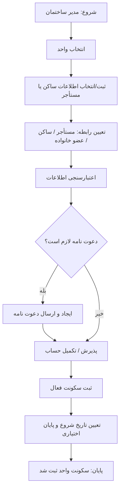

# Buildino — P08 | مدیریت سکونت و ساکن واحد

> **نسخه اصلاح‌شده برای داشبورد تحت وب Laravel**
> **مرجع:** نمودار P08 «فرآیند مدیریت سکونت و ساکن واحد — تعریف ساکن، مستأجر یا عضو خانواده»
> **هدف:** شرح فرآیند برای بررسی پیاده‌سازی موجود، سپس طراحی و پیاده‌سازی **UI واقعی داشبورد Laravel** بر اساس همان فرآیند.
> **آغازکننده:** مدیر ساختمان.
> **محدوده:** مدیریت رابطه سکونت اشخاص با واحد؛ مستقل از مالکیت واحد (P07) و نقش‌ها/مجوزهای سامانه (P05).
> **تذکر:** پشته Frontend را از Repository شناسایی کن؛ **Blade، Livewire، Inertia، Vue یا React را از پیش فرض نکن**. این پروژه در این وظیفه **Flutter نیست**.

## ۱. شرح دقیق فرآیند P08

| مرحله | مسئول | اقدام و خروجی |
| --- | --- | --- |
| ۱ | مدیر ساختمان | از فهرست ساختمان/واحدها، **واحد موردنظر** را انتخاب می‌کند. |
| ۲ | مدیر ساختمان | **اطلاعات ساکن یا مستأجر** را ثبت می‌کند یا، در صورت پشتیبانی سامانه، شخص موجود را انتخاب می‌کند. مرجع نمودار: «اطلاعات ساکن (مرجع هویتی و تماس)». |
| ۳ | مدیر ساختمان | **نوع رابطه شخص با واحد** را انتخاب می‌کند: **مستأجر / ساکن / عضو خانواده**. |
| ۴ | سامانه | **اعتبارسنجی اطلاعات** هویتی، تماس و اطلاعات رابطه را بر اساس قواعد موجود پروژه انجام می‌دهد. |
| ۵ | سامانه | شرط **«دعوت‌نامه لازم است؟»** را ارزیابی می‌کند. |
| ۵-الف | سامانه؛ اگر «بله» | **دعوت‌نامه ایجاد و ارسال** می‌شود، سپس جریان به مرحله **«پذیرش/تکمیل حساب»** می‌رسد. |
| ۵-ب | سامانه؛ اگر «خیر» | **دعوت‌نامه جدید ایجاد نمی‌شود**؛ مسیرِ رسم‌شده مستقیماً به گام **«پذیرش/تکمیل حساب»** متصل است. معنای «پذیرش» در نبود دعوت‌نامه از نمودار روشن نیست؛ اگر شخص حساب آماده دارد، سامانه نباید پذیرش دعوت‌نامه ناموجود را تحمیل کند. |
| ۶ | سامانه | پس از تحقق پیش‌نیازهای مربوط به حساب، **سکونت فعال** برای شخص و واحد ثبت می‌شود. |
| ۷ | سامانه | **تاریخ شروع سکونت** و **در صورت نیاز تاریخ پایان** تعیین و در سوابق سکونت نگهداری می‌شوند. |
| ۸ | سامانه | پایان موفق: **«سکونت واحد ثبت شد»**. |

### نمایش فشرده جریان

> **نکته تفسیری:** مسیر خطای اعتبارسنجی در تصویر ترسیم نشده؛ پیاده‌سازی باید خطا را بر اساس سازوکار موجود داشبورد نشان دهد و از ثبت نادرست جلوگیری کند. نمودار مرحله «ثبت سکونت فعال» را پیش از «تعیین تاریخ» نشان می‌دهد؛ در UI می‌توان ورودی تاریخ را پیش از ثبت نهایی گرفت، اما سازگاری عملیات ذخیره‌سازی باید حفظ شود.

## ۲. قواعد دامنه‌ای که باید رعایت شوند

1. **شخص/حساب کاربری، مالکیت و سکونت سه مفهوم متفاوت‌اند.** ایجاد ساکن نباید خودکار به معنی ایجاد مالکیت جدید باشد.
2. **نوع رابطه سکونت** (`مستأجر`، `ساکن`، `عضو خانواده`) با **نقش دسترسی** در داشبورد یکی نیست؛ نقش‌ها و سطح دسترسی را از قواعد فعلی پروژه پیروی بده.
3. هر ثبت باید به **واحد انتخاب‌شده** مرتبط باشد؛ ثبت نامشخص یا روی واحد اشتباه قابل‌قبول نیست.
4. **دعوت‌نامه شرطی است.** اگر لازم نباشد، نه دعوت‌نامه ساختگی بساز و نه مرحله پذیرشِ بی‌معنا را اجباری کن.
5. اطلاعات شخص از ساختار داده و اعتبارسنجی موجود استفاده کند. فیلد اجباری، نوع شناسه، قانون تکراری بودن، وضعیت حساب یا API جدید را بدون شاهد در کد فرض نکن.
6. **تاریخ شروع** جزو اطلاعات فرآیند است؛ **تاریخ پایان اختیاری** است. قواعد تاریخی/تقویمی را از پیاده‌سازی موجود استخراج کن، نه از حدس.
7. فقط بعد از موفقیت واقعی عملیات، **ثبت موفق** نمایش داده شود. خطای اعتبارسنجی، خطای شبکه/سرور و ارسال دوباره ناخواسته مدیریت شوند.
8. اگر کاربر حساب یا سابقه سکونت از قبل دارد، رفتار ثبت مجدد، ظرفیت رابطه‌ها، هم‌زمانی سکونت‌ها و رفع تعارض باید از منطق واقعی سیستم مشخص شود؛ نمودار در این باره ساکت است.

## ۳. ابهامات نمودار: الزامات قطعی محسوب نشوند

- دقیقاً بر چه مبنایی سامانه تعیین می‌کند **دعوت‌نامه لازم است یا خیر**؟ داشتن حساب، عضویت قبلی، وضعیت شماره تماس یا شرط دیگری؟
- در شاخه «خیر»، عنوان مرحله بعدی هنوز «پذیرش/تکمیل حساب» است؛ در نبود دعوت‌نامه **آیا فقط بررسی وضعیت حساب** مدنظر است؟
- آیا ثبت رابطه سکونت **پس از پذیرش دعوت‌نامه** باید انجام شود یا می‌توان رکوردی با وضعیت انتظار داشت؟
- چه کسی تاریخ شروع/پایان را تعیین می‌کند و تاریخ پیش‌فرض چیست؟
- آیا یک شخص می‌تواند در چند واحد ثبت شود و آیا هر واحد می‌تواند چند ساکن هم‌زمان داشته باشد؟
- رابطه سکونت موجود چگونه پایان می‌یابد یا تغییر می‌کند؟
- این مراحل در Backend و API موجود تا چه اندازه پشتیبانی شده‌اند؟

اگر Repository پاسخی ندارد، در گزارش نهایی کوتاه به‌عنوان **ابهام یا وابستگی** ثبت کن؛ پاسخ دلخواه نساز.

## ۴. نیازمندی‌های UI داشبورد Laravel

**هدف، پیاده‌سازی در Frontend واقعی پروژه است؛ نه تولید ماکاپ و نه ساخت اپ موبایل.** معماری و الگوی ناوبری، فرم، جدول، کامپوننت، Modal/Drawer، اعتبارسنجی، مدیریت وضعیت و استایل فعلی Repository ملاک هستند.

- **ورود به مدیریت سکونت:** دسترسی از محل مناسب در جریان مدیریت واحد/ساختمان، مطابق ساختار فعلی داشبورد؛ بررسی مجوز مدیر ساختمان طبق middleware/Policy/Gate موجود.
- **انتخاب واحد:** نمایش واحد فعلی و مشخصات لازم برای تشخیص آن، با امکان انتخاب/تغییر از مسیر موجود.
- **مشخصات شخص:** فرم یا انتخاب شخص موجود با اطلاعات هویتی و تماسِ پشتیبانی‌شده در پروژه؛ کنترل خطا در سطح فیلد.
- **نوع رابطه:** انتخاب روشن یکی از سه مقدار `مستأجر / ساکن / عضو خانواده`؛ از مقادیر enum/constant/schema موجود تبعیت کن.
- **اعتبارسنجی:** loading، خطای قابل‌فهم، اصلاح ورودی، جلوگیری از submit تکراری و حفظ وضعیت فرم هنگام خطا.
- **دعوت‌نامه:** فقط در شاخه لازم، نمایش وضعیت ایجاد/ارسال/انتظار پذیرش، تا حد پشتیبانی Backend. در شاخه بدون دعوت‌نامه، ادامه متناسب با حساب موجود.
- **وضعیت حساب:** نمایش «پذیرفته‌شده/نیازمند تکمیل/در انتظار» فقط وقتی اطلاعات واقعی آن موجود است؛ موفقیت فرضی نمایش نده.
- **تاریخ‌ها:** ورود/نمایش تاریخ شروع و پایان اختیاری با کنترل‌های تاریخ موجود پروژه و سازگاری با قواعد ذخیره‌سازی آن.
- **نتیجه:** نمایش موفقیت بعد از پاسخ موفق Backend و انعکاس سکونت ثبت‌شده در نمای واحد. پوشش empty، loading، error و success.
- **کیفیت بصری:** فارسی و **RTL واقعی**، responsive برای عرض‌های رایج داشبورد، دسترس‌پذیری پایه، ظاهر یکپارچه با Design System/کامپوننت‌ها/توکن‌های CSS موجود. **از بازطراحی سراسری، CSS و dependency تکراری یا استایل‌های نامرتبط پرهیز کن.**

**محدودیت مهم:** این درخواست در اصل Frontend/UI است. بدون نیاز ضروری و بدون قرارداد موجود، schema/migration، مدل دامنه، API یا منطق تجاری جدید نساز. برای قابلیت فاقد پشتیبانی Backend، وابستگی را گزارش کن؛ ثبت یا ارسال دعوت‌نامه جعلی شبیه‌سازی نکن.

## ۵. دستور اجرایی مستقیم به Codex

> **وظیفه:** جریان P08 را در **داشبورد وب Laravel پروژه Buildino** بررسی و **UI آن را در Repository پیاده‌سازی** کن. این کار مربوط به Flutter نیست.
>
> 1. **شناخت سریع پشته:** فقط فایل‌های مرتبط مثل `composer.json`، `package.json`، routeهای Laravel، کنترلرهای مرتبط، view/componentهای داشبورد و ساختار frontend را بررسی کن تا مشخص شود UI با Blade، Livewire، Inertia/Vue/React یا ترکیبی از آن‌ها ساخته شده است. **تکنولوژی را حدس نزن.**
> 2. **بررسی وضع موجود:** مسیرهای مدیریت ساختمان/واحد/ساکن، مدل‌ها و قراردادهای موجود، اعتبارسنجی، دعوت‌نامه و سطح دسترسی مدیر ساختمان را به‌صورت هدفمند بررسی کن. خیلی کوتاه مشخص کن کدام گام‌های P08 حاضر یا ناقص‌اند.
> 3. **پیاده‌سازی UI:** با همان پشته، ساختار مسیرها و کامپوننت‌های موجود، جریان انتخاب واحد → ثبت/انتخاب شخص → نوع رابطه → اعتبارسنجی → دعوت‌نامه شرطی → وضعیت حساب → تاریخ‌ها → موفقیت را طراحی و پیاده‌سازی کن. از داده‌ها و APIهای واقعی موجود استفاده کن؛ رفتار جعلی نساز.
> 4. **کیفیت و محدوده:** طراحی حرفه‌ای، فارسی، RTL، responsive و همخوان با Design System فعلی باشد. مسیرهای loading، empty، validation error، server error و success را پوشش بده. ساختار فعلی Laravel، authorization و منطق Backend را بی‌دلیل تغییر نده. اگر مرحله‌ای به‌علت نبود سرویس قابل تکمیل نیست، بخش قابل اجرا را بساز و مانع را شفاف گزارش کن.
> 5. **تأیید حداقلی:** فقط آزمون‌ها یا build/checkهای هدفمند و واقعاً ضروری برای فایل‌های تغییرکرده را اجرا کن؛ از عملیات طولانی نامرتبط خودداری کن.
>
> **مصرف توکن بسیار مهم است:** تا جای امکان **کمترین توکن** را مصرف کن. جست‌وجوی هدفمند انجام بده؛ فایل‌ها را کامل dump نکن؛ تحلیل، لاگ و شرح تصمیم‌های طولانی تولید نکن؛ از تکرار و refactor نامرتبط پرهیز کن. بدون قربانی‌کردن کیفیت UI و صحت فرآیند، از کد موجود استفاده مجدد کن. **خروجی نهایی فقط:** خلاصه بسیار کوتاه تغییرات، مسیر فایل‌های تغییرکرده، نتیجه بررسی هدفمند و ابهام/مانع باقی‌مانده.

## ۶. معیار پذیرش نهایی

- [ ] این تغییرات در **داشبورد Laravel** انجام شده‌اند و از پشته Frontend واقعی Repository استفاده می‌کنند.
- [ ] مسیر انتخاب واحد، ثبت/انتخاب شخص و سه نوع رابطه در UI قابل انجام است.
- [ ] اعتبارسنجی و وضعیت‌های خطا/بارگذاری/موفقیت پوشش داده شده‌اند.
- [ ] شاخه دعوت‌نامه لازم/غیرلازم مطابق خدمات موجود رعایت شده است.
- [ ] تاریخ شروع و تاریخ پایان اختیاری، مطابق قابلیت و قواعد موجود نمایش/ثبت می‌شوند.
- [ ] رکورد نهایی به واحد صحیح متصل است و ثبت موفق صرفاً با تأیید واقعی نمایش داده می‌شود.
- [ ] مالکیت (P07) با سکونت (P08) اشتباه گرفته نشده است؛ مجوزها از سازوکار موجود تبعیت می‌کنند.
- [ ] UI فارسی، RTL، responsive و هماهنگ با ظاهر موجود داشبورد است.
- [ ] تغییرات غیرضروری یا قرارداد ساختگی به Backend تحمیل نشده و ابهامات صریحاً گزارش شده‌اند.
