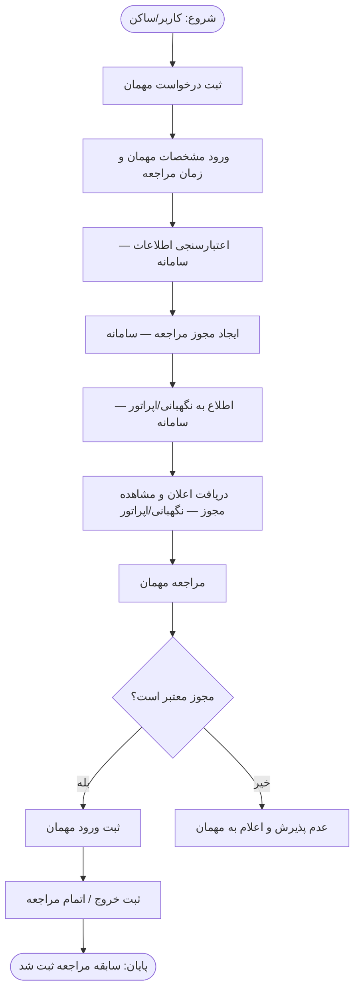

# P09 — فرآیند مدیریت مهمان و مراجعه | Buildino

> **عنوان نمودار:** فرآیند مدیریت مهمان و مراجعه  
> **زیرعنوان:** ثبت، تأیید و کنترل ورود مهمان  
> **هدف این سند:** انتقال دقیق منطق نمودار P09 به Codex. این سند صرفاً توصیف فرآیند است؛ دستور طراحی UI، پیاده‌سازی یا تغییر کد نیست.

## ۱. هدف فرآیند

ساکن یا کاربر ساختمان، مراجعه یک مهمان را از قبل ثبت می‌کند. سامانه اطلاعات درخواست را اعتبارسنجی و برای مراجعه مجوز ایجاد می‌کند، نگهبانی/اپراتور را مطلع می‌سازد، و هنگام مراجعه مهمان اعتبار مجوز بررسی می‌شود. مراجعه معتبر با ثبت ورود و سپس خروج/اتمام به سابقه مراجعه تبدیل می‌شود؛ مراجعه فاقد مجوز معتبر پذیرفته نمی‌شود.

## ۲. نقش‌ها (Swimlanes)

| نقش | مسئولیت‌های صریح در نمودار |
|---|---|
| **کاربر/ساکن** | ثبت درخواست مهمان و وارد کردن مشخصات مهمان و زمان مراجعه |
| **سامانه** | اعتبارسنجی اطلاعات، ایجاد مجوز مراجعه، اطلاع به نگهبانی/اپراتور، بررسی اعتبار مجوز، ثبت ورود، ثبت خروج/اتمام و نگهداری سابقه مراجعه |
| **نگهبانی/اپراتور** | دریافت اعلان و مشاهده مجوز مراجعه |

**توجه:** نمودار، ثبت ورود و خروج را در ستون «سامانه» قرار می‌دهد؛ مشخص نمی‌کند چه شخصی این عملیات را آغاز می‌کند. همچنین عمل مستقلی تحت عنوان «تأیید دستی نگهبان» در مراحل ترسیم نشده است.

## ۳. ترتیب مراحل

1. **شروع:** کاربر/ساکن فرآیند را آغاز می‌کند.
2. **ثبت درخواست مهمان:** کاربر/ساکن درخواست مراجعه ایجاد می‌کند.
3. **ورود اطلاعات:** کاربر/ساکن «مشخصات مهمان» و «زمان مراجعه» را وارد می‌کند.
4. **اعتبارسنجی اطلاعات:** سامانه اطلاعات واردشده را بررسی می‌کند.
5. **ایجاد مجوز مراجعه:** در مسیر ترسیم‌شده، سامانه پس از اعتبارسنجی، مجوز مراجعه ایجاد می‌کند.
6. **اطلاع به نگهبانی/اپراتور:** سامانه وجود مجوز را به نگهبانی/اپراتور اطلاع می‌دهد.
7. **مشاهده مجوز:** نگهبانی/اپراتور اعلان را دریافت می‌کند و مجوز را می‌بیند.
8. **مراجعه مهمان:** مهمان برای ورود مراجعه می‌کند.
9. **بررسی اعتبار مجوز:** سامانه تصمیم می‌گیرد که «مجوز معتبر است؟»
   - **بله:** ورود مهمان ثبت می‌شود؛ سپس خروج مهمان یا اتمام مراجعه ثبت می‌شود؛ فرآیند با نتیجه «سابقه مراجعه ثبت شد» پایان می‌یابد.
   - **خیر:** مهمان پذیرفته نمی‌شود و عدم پذیرش به او اعلام می‌شود. برای این مسیر، مرحله دیگری در نمودار تعریف نشده است.

## ۴. مسیرهای نهایی

### مسیر موفق

`ثبت درخواست ← ورود مشخصات و زمان مراجعه ← اعتبارسنجی ← ایجاد مجوز ← اعلان نگهبانی ← مشاهده مجوز ← مراجعه مهمان ← مجوز معتبر ← ثبت ورود ← ثبت خروج/اتمام ← ثبت سابقه مراجعه`

**خروجی:** سابقه مراجعه مهمان ثبت شده است.

### مسیر ناموفق در زمان مراجعه

`مراجعه مهمان ← بررسی اعتبار مجوز ← مجوز نامعتبر ← عدم پذیرش و اعلام به مهمان`

**خروجی:** ورود مهمان در این مسیر نباید به‌عنوان ورود مجاز ثبت شود. نمودار درباره ثبت سابقه تلاش ناموفق یا علت رد تصمیمی ارائه نکرده است.

## ۵. قواعدی که مستقیماً از نمودار برداشت می‌شوند

- ثبت درخواست و اطلاعات مهمان، قبل از ایجاد مجوز انجام می‌شود.
- ایجاد مجوز بعد از مرحله اعتبارسنجی اطلاعات قرار دارد.
- نگهبانی/اپراتور باید از مجوز ایجادشده مطلع شود و بتواند آن را مشاهده کند.
- اعتبار مجوز **هنگام مراجعه مهمان** بررسی می‌شود؛ صرف ایجاد مجوز به معنی ثبت ورود نیست.
- ثبت ورود فقط در شاخه «مجوز معتبر است؟ → بله» نمایش داده شده است.
- بعد از ثبت ورود، مرحله ثبت خروج/اتمام مراجعه وجود دارد.
- نتیجه پایان مسیر موفق، ثبت سابقه مراجعه است.

## ۶. ابهامات و مواردی که نباید فرض شوند

1. **اعتبارسنجی ناموفق:** نمودار مشخص نکرده در صورت نامعتبر بودن اطلاعات اولیه چه خطا یا مسیر اصلاحی وجود دارد.
2. **تعریف اعتبار مجوز:** معیارهایی مثل بازه زمانی، انقضا، لغو، دفعات مجاز استفاده و تطبیق هویت در تصویر تعیین نشده‌اند.
3. **تأیید دستی:** با وجود کلمه «تأیید» در زیرعنوان، مرحله‌ای برای تأیید یا رد درخواست توسط ساکن، مدیر ساختمان یا نگهبان نمایش داده نشده است.
4. **عامل ثبت ورود/خروج:** مشخص نیست نگهبان دکمه ثبت را می‌زند، سامانه خودکار ثبت می‌کند یا روش دیگری وجود دارد.
5. **نحوه اطلاع‌رسانی:** کانال اعلان (داشبورد، پیامک و غیره) تعیین نشده است.
6. **جزئیات اطلاعات مهمان:** فیلدهای الزامی، نوع مدرک شناسایی، تعداد همراهان و قالب زمان مراجعه مشخص نشده‌اند.
7. **مسیر اضافی در تصویر:** یک پیکان سیاه از «مراجعه مهمان» مستقیم به «عدم پذیرش» رسم شده، اما شرط یا عنوان آن معلوم نیست. نباید بدون تأیید، آن را قانون مستقل دیگری در نظر گرفت. مسیر «مجوز نامعتبر → عدم پذیرش» به‌صورت صریح مشخص است.
8. **مرجع واحد/ساختمان:** درخواست‌دهنده «کاربر/ساکن» است، اما نحوه انتخاب واحد یا اتصال درخواست به واحد در این نمودار شرح داده نشده است.

## ۷. فلوچارت متنی برای Codex

**نکته برای Codex:** این فلوچارت فقط مسیرهای دارای شرط صریح و روشن در نمودار را مدل می‌کند. مسیرهای خطای اعتبارسنجی و پیکان مستقیمِ بدون شرط به «عدم پذیرش» عمداً به آن افزوده نشده‌اند، چون منطقشان در تصویر تعریف نشده است.
