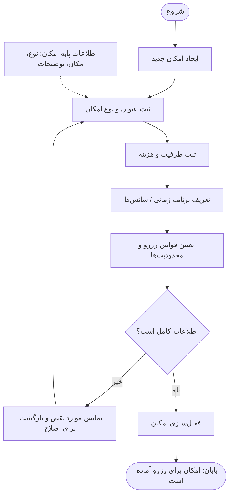

# Buildino — P10: فرآیند تعریف و پیکربندی امکانات ساختمان

> **منبع:** نمودار فرآیند P10  
> **هدف سند:** انتقال دقیق منطق این فرآیند به Codex برای درک و بررسی ساختار موجود پروژه.  
> **زمینه پروژه:** داشبورد تحت وب Buildino مبتنی بر Laravel. این سند درباره منطق فرآیند است و دستور طراحی UI یا پیاده‌سازی کد محسوب نمی‌شود.

## ۱. هدف فرآیند

مدیر ساختمان می‌تواند یک **امکان قابل رزرو** (Facility) را تعریف و پیکربندی کند. برای این کار، اطلاعات پایه امکان، ظرفیت و هزینه، برنامه زمانی/سانس‌ها و قوانین رزرو و محدودیت‌ها ثبت می‌شود. سامانه پیش از فعال‌سازی کامل بودن اطلاعات را بررسی می‌کند. تنها در مسیر موفق، امکان فعال و برای رزرو آماده می‌شود.

## ۲. نقش‌ها و مسئولیت‌ها

| نقش / بخش | مسئولیت |
|---|---|
| **مدیر ساختمان** | شروع فرآیند؛ ایجاد امکان؛ وارد کردن عنوان، نوع، ظرفیت و هزینه؛ تعریف برنامه زمانی و قوانین رزرو؛ اصلاح اطلاعات ناقص |
| **سامانه** | بررسی کامل بودن اطلاعات، اعلام موارد نقص و فعال‌سازی امکان در صورت تأیید |
| **اطلاعات امکانات** | داده‌های پایه مرتبط با امکان، شامل **نوع، مکان و توضیحات**؛ این ستون در نمودار نقش کاربر جداگانه ندارد و منبع داده است |

## ۳. توالی گام‌ها

1. **شروع:** مدیر ساختمان فرآیند تعریف امکان را آغاز می‌کند.
2. **ایجاد امکان جدید:** مدیر ساختمان اقدام به ایجاد یک امکان جدید برای ساختمان می‌کند.
3. **ثبت عنوان و نوع امکان:** عنوان و نوع امکان ثبت می‌شوند. مطابق نمودار، اطلاعات پایه امکان شامل **نوع، مکان و توضیحات** نیز در این مرحله لحاظ می‌شود.
4. **ثبت ظرفیت و هزینه:** اطلاعات ظرفیت استفاده از امکان و هزینه مربوط به آن ثبت می‌شوند.
5. **تعریف برنامه زمانی/سانس‌ها:** زمان‌بندی استفاده یا سانس‌های در دسترس امکان تعریف می‌شود.
6. **تعیین قوانین رزرو و محدودیت‌ها:** مدیر ساختمان قوانین و محدودیت‌های مربوط به رزرو امکان را مشخص می‌کند.
7. **بررسی کامل بودن اطلاعات:** سامانه بررسی می‌کند که اطلاعات لازم برای فعال‌سازی کامل هستند یا خیر.
   - **خیر — اطلاعات ناقص است:** سامانه **موارد نقص را نمایش می‌دهد** و فرآیند برای اصلاح اطلاعات به مدیر ساختمان بازمی‌گردد. پس از اصلاح، بررسی کامل بودن باید مجدداً انجام شود. **فعال‌سازی انجام نمی‌شود.**
   - **بله — اطلاعات کامل است:** سامانه به مرحله فعال‌سازی می‌رود.
8. **فعال‌سازی امکان:** سامانه امکان تعریف‌شده را فعال می‌کند.
9. **پایان موفق:** وضعیت نهایی فرآیند: **«امکان برای رزرو آماده است»**.

## ۴. نمودار منطقی فرآیند

> مسیر بازگشت از خطا در نمودار منطقی، بیانگر **اصلاح بخش‌های ناقص** است؛ لزوماً به معنای وارد کردن مجدد تمام اطلاعات نیست.

## ۵. قواعدی که مستقیماً از نمودار قابل برداشت‌اند

- ایجاد امکان توسط **مدیر ساختمان** آغاز می‌شود.
- پیکربندی امکان شامل این دسته داده‌هاست: **عنوان و نوع، اطلاعات پایه (نوع/مکان/توضیحات)، ظرفیت و هزینه، برنامه زمانی/سانس‌ها، قوانین رزرو و محدودیت‌ها**.
- پیش از فعال‌سازی، سامانه یک **مرحله تصمیم‌گیری بر اساس کامل بودن اطلاعات** دارد.
- در صورت نقص اطلاعات، سامانه باید **موارد نقص را نمایش دهد** و امکان اصلاح فراهم باشد.
- تنها بعد از عبور از بررسی کامل بودن، امکان **فعال** و **آماده رزرو** می‌شود.
- **فرآیند انجام رزرو توسط کاربران، پرداخت هزینه، لغو رزرو و مدیریت حضور در این نمودار نشان داده نشده است** و جزو P10 به‌عنوان الزام قطعی محسوب نمی‌شود.

## ۶. موارد نامشخص در تصویر (نباید بدون بررسی، الزام قطعی فرض شوند)

- فیلدهای دقیق اجباری، قالب داده‌ها و قواعد صحت‌سنجی هر فیلد.
- اینکه هزینه می‌تواند صفر باشد یا نحوه محاسبه/پرداخت آن چگونه است.
- ظرفیت برای کل امکان است یا برای هر سانس.
- جزئیات قوانین رزرو (مانند حداکثر دفعات، مهلت رزرو یا شرایط لغو).
- اینکه اطلاعات ناقص به‌صورت پیش‌نویس ذخیره می‌شوند یا خیر.
- مسیر و مجوز ویرایش یا غیرفعال‌سازی امکانات پس از فعال‌سازی.
- نحوه ارتباط امکان با ساختمان، مجتمع یا واحد در مدل داده.

**دستور تفسیر برای Codex:** این سند توصیف جریان P10 است. آن را مبنای درک فرآیند قرار بده؛ موارد نامشخص را از کد و نیازمندی‌های موجود بررسی کن و رفتار یا الزام جدیدی را صرفاً بر اساس حدس اضافه نکن.
