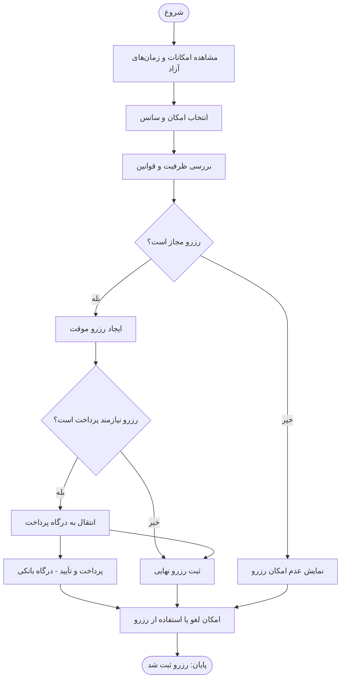

# Buildino — P11: فرآیند رزرو امکانات ساختمان

> **نوع سند:** توصیف فرآیند برای درک توسط Codex  
> **منبع:** نمودار P11 ارسالی  
> **دامنه:** فقط منطق فرآیند؛ بدون درخواست طراحی رابط کاربری، تغییر کد یا تعریف API

## ۱. هدف فرآیند

امکان رزرو یک امکان ساختمان در سانس مشخص، با بررسی ظرفیت و قوانین و در صورت نیاز طی‌کردن مسیر پرداخت. فرآیند از مشاهده امکانات و زمان‌های آزاد آغاز می‌شود و در نمودار تا ثبت رزرو و امکان استفاده یا لغو آن ادامه می‌یابد.

## ۲. نقش‌ها (Swimlanes)

| نقش | مسئولیت در نمودار |
|---|---|
| **کاربر** | مشاهده امکانات و زمان‌های آزاد، انتخاب امکان و سانس؛ دریافت پیام عدم امکان رزرو |
| **سامانه** | بررسی ظرفیت و قوانین، تشخیص مجازبودن رزرو، ایجاد رزرو موقت، تشخیص نیاز به پرداخت، انتقال به درگاه، ثبت رزرو نهایی، فراهم‌کردن امکان لغو یا استفاده از رزرو |
| **درگاه پرداخت / مدیر** | در تصویر یک مسیر با عنوان «پرداخت و تأیید (درگاه بانکی)» نشان داده شده است؛ اقدام مستقلی برای تأیید مدیر مشخص نشده است |

## ۳. توالی مراحل مطابق نمودار

1. **شروع:** کاربر فرآیند رزرو را آغاز می‌کند.
2. **مشاهده امکانات و زمان‌های آزاد — کاربر:** فهرست امکانات ساختمان و زمان‌های آزاد برای رزرو نمایش داده می‌شود.
3. **انتخاب امکان و سانس — کاربر:** کاربر امکان و بازه/سانس موردنظر را انتخاب می‌کند.
4. **بررسی ظرفیت و قوانین — سامانه:** سامانه ظرفیت و قواعد مربوط به رزرو انتخاب‌شده را بررسی می‌کند.
5. **تصمیم اول: «رزرو مجاز است؟» — سامانه:**
   - **خیر:** «نمایش عدم امکان رزرو». در نمودار، از این مرحله یک پیکان به «امکان لغو یا استفاده از رزرو» متصل شده است؛ این اتصال از نظر مفهومی مبهم است، چون در این مسیر رزروی ثبت نشده است.
   - **بله:** ادامه به مرحله «ایجاد رزرو موقت».
6. **ایجاد رزرو موقت — سامانه:** یک رزرو موقت برای انتخاب کاربر ایجاد می‌شود. شرایط اعتبار/انقضای آن در نمودار مشخص نیست.
7. **تصمیم دوم: «رزرو نیازمند پرداخت است؟» — سامانه:**
   - **خیر:** مسیر مستقیماً به «ثبت رزرو نهایی» می‌رود.
   - **بله:** مسیر به «انتقال به درگاه پرداخت» می‌رود.
8. **انتقال به درگاه پرداخت — سامانه:** کاربر برای پرداخت به درگاه بانکی ارجاع می‌شود.
9. **پرداخت و تأیید (درگاه بانکی) — درگاه پرداخت / مدیر:** پرداخت و تأیید در نمودار نشان داده شده است. مسیر مشخصی برای پرداخت ناموفق یا لغوشده وجود ندارد.
10. **ثبت رزرو نهایی — سامانه:** این مرحله در مسیر «بدون نیاز به پرداخت» صریح است. **نکته:** در تصویر، از جعبه «انتقال به درگاه پرداخت» نیز پیکانی مستقیم به «ثبت رزرو نهایی» رسم شده، در حالی که خروجی «پرداخت و تأیید» به «امکان لغو یا استفاده از رزرو» وصل است. بنابراین شرط و ترتیب ثبت نهایی در مسیر پرداختی کاملاً روشن نیست.
11. **امکان لغو یا استفاده از رزرو — سامانه:** نمودار این مرحله را پس از ثبت نهایی و نیز بعد از «پرداخت و تأیید» نشان می‌دهد. مراحل داخلی لغو یا استفاده بیان نشده‌اند.
12. **پایان:** نقطه پایان در تصویر «رزرو ثبت شد» نام دارد. این عنوان برای مسیر موفق مفهوم دارد؛ ولی اتصال مسیر «عدم امکان رزرو» به همین پایان، نیازمند شفاف‌سازی است.

## ۴. شاخه‌های تصمیم‌گیری

### تصمیم A — رزرو مجاز است؟

- **ورودی تصمیم:** امکان، سانس و نتیجه بررسی ظرفیت و قوانین.
- **بله:** ایجاد رزرو موقت.
- **خیر:** نمایش عدم امکان رزرو؛ ایجاد رزرو موقت یا نهایی در این شاخه نشان داده نشده است.

### تصمیم B — رزرو نیازمند پرداخت است؟

- **پیش‌شرط:** مسیر مجازبودن رزرو طی شده و رزرو موقت ایجاد شده است.
- **خیر:** ثبت رزرو نهایی.
- **بله:** انتقال به درگاه پرداخت و انجام پرداخت و تأیید.
- **نکته:** نمودار تعیین نمی‌کند چه رخدادی در شاخه پرداختی باید ثبت رزرو نهایی را قطعی کند.

## ۵. نمودار متنی جریان اصلی

> دیاگرام زیر **اتصالات ترسیم‌شده در تصویر** را بازتاب می‌دهد؛ اتصالات مبهم به معنی تأیید قواعد تجاری نیستند.

## ۶. نکات و ابهامات مهم برای تفسیر درست نمودار

1. **ثبت نهایی در مسیر پرداخت:** تصویر هم انتقال به درگاه را به ثبت نهایی متصل می‌کند و هم تأیید درگاه را مستقیم به مرحله لغو/استفاده؛ بنابراین از روی تصویر نمی‌توان با قطعیت نتیجه گرفت ثبت نهایی قبل یا بعد از تأیید موفق پرداخت انجام می‌شود.
2. **مسیر عدم امکان رزرو:** اتصال «نمایش عدم امکان رزرو» به «امکان لغو یا استفاده از رزرو» و سپس «رزرو ثبت شد» از نظر منطقی ناسازگار است. این اتصال در نمودار وجود دارد، اما نباید به‌عنوان ثبت رزرو ناموفق تفسیر شود.
3. **پرداخت ناموفق، لغوشده یا نامشخص:** در نمودار شاخه‌ای برای این حالت‌ها تعریف نشده است.
4. **قواعد ظرفیت و رزرو:** جزئیات ظرفیت، محدودیت‌های زمانی، اولویت‌ها، تداخل سانس‌ها و معیار مجازبودن رزرو تعیین نشده‌اند؛ فقط اصل «بررسی ظرفیت و قوانین» الزام صریح تصویر است.
5. **مدت اعتبار رزرو موقت:** زمان انقضا، آزادسازی ظرفیت و وضعیت‌های داخلی رزرو موقت مشخص نیست.
6. **لغو و استفاده از رزرو:** وجود این امکان در تصویر آمده، ولی روش لغو، مهلت لغو، بازپرداخت، ثبت استفاده و نتیجه هر یک شرح داده نشده است.
7. **نقش مدیر:** عنوان ستون سوم «درگاه پرداخت/مدیر» است؛ اما مرحله عملیاتی مستقل برای مدیر ترسیم نشده است. تأیید دستی مدیر را نباید از نمودار فرض کرد.
8. **سازگاری با P10:** این فرآیند درباره رزرو امکاناتی است که قبلاً تعریف و پیکربندی شده‌اند؛ اما تصویر P11 جزئیات نحوه تعریف امکان را تکرار نمی‌کند.

## ۷. جمع‌بندی برای Codex

- **مسیر پایه:** مشاهده امکانات و زمان‌های آزاد ← انتخاب امکان و سانس ← بررسی ظرفیت و قوانین ← تصمیم مجازبودن رزرو.
- **مسیر غیرمجاز:** نمایش عدم امکان رزرو؛ **نباید بدون شواهد دیگر به معنی ثبت رزرو تلقی شود**.
- **مسیر مجاز:** ایجاد رزرو موقت ← تشخیص نیاز به پرداخت.
- **بدون پرداخت:** ثبت رزرو نهایی ← امکان لغو یا استفاده از رزرو.
- **با پرداخت:** انتقال به درگاه ← پرداخت و تأیید؛ جزئیات اتصال تأیید موفق به ثبت نهایی در نمودار مبهم است.
- **پایان موفق:** رزرو ثبت‌شده و امکان لغو یا استفاده، مطابق عنوان پایان نمودار.

**اصل تفسیر:** مراحل و تصمیم‌های صریح تصویر را مبنا قرار بده؛ موارد مبهم را به‌عنوان ابهام نگه دار و هیچ رفتار تکمیلی (از جمله تأیید مدیر، بازپرداخت، انقضای رزرو موقت یا نحوه برخورد با پرداخت ناموفق) را نیازمندی قطعی این نمودار معرفی نکن.
