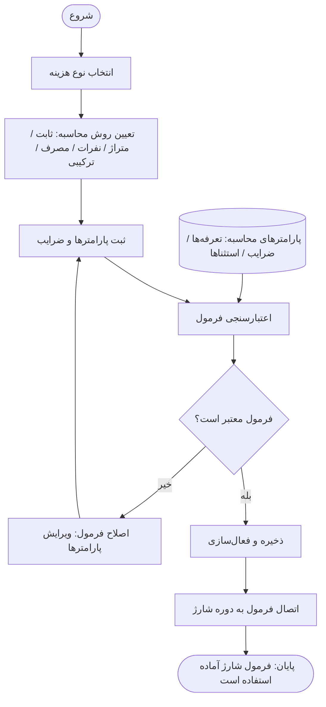

# Buildino — P12: فرآیند تعریف فرمول شارژ

> **هدف این سند:** انتقال دقیق منطق فرآیند P12 از نمودار به متن قابل فهم برای Codex. این سند فقط شرح فرآیند است و دستور طراحی UI، تغییر کد یا تعریف API جدید نیست.
>
> **عنوان نمودار:** فرآیند تعریف فرمول شارژ — تنظیم قواعد محاسبه شارژ ساختمان

## ۱. هدف فرآیند

مدیر مالی یا مدیر ساختمان بتواند برای یک **نوع هزینه**، **روش محاسبه شارژ** را انتخاب کند، پارامترها و ضرایب آن را ثبت کند و پس از اعتبارسنجی سامانه، فرمول معتبر را ذخیره و فعال کرده و به **دوره شارژ** متصل کند.

**نتیجه موفق:** «فرمول شارژ آماده استفاده است.»

این فرآیند **تعریف و آماده‌سازی قاعده محاسبه** را توصیف می‌کند؛ نمودار، اجرای محاسبات واقعی شارژ، صدور بدهی، پرداخت یا تسویه را نشان نمی‌دهد.

## ۲. نقش‌ها و داده‌های ورودی

| نقش / منبع | مسئولیت در نمودار |
| --- | --- |
| **مدیر مالی / مدیر ساختمان** | آغاز فرآیند، انتخاب نوع هزینه، تعیین روش محاسبه، ثبت پارامترها و ضرایب و اصلاح اطلاعات نامعتبر |
| **سامانه** | اعتبارسنجی فرمول، تعیین معتبر یا نامعتبر بودن آن، ذخیره و فعال‌سازی فرمول معتبر و اتصال آن به دوره شارژ |
| **پارامترهای محاسبه** | منبع اطلاعات موردنیاز برای اعتبارسنجی شامل **تعرفه‌ها، ضرایب و استثناها**؛ این ستون در نمودار نقش کاربر مستقل ندارد |

## ۳. مراحل دقیق به ترتیب نمودار

### مرحله ۱ — آغاز

مدیر مالی یا مدیر ساختمان فرآیند تعریف فرمول شارژ را شروع می‌کند.

### مرحله ۲ — انتخاب نوع هزینه

مدیر، **نوع هزینه**‌ای را که فرمول برای آن تعریف می‌شود انتخاب می‌کند.

> نمودار فهرست انواع هزینه را تعیین نکرده است؛ هیچ نوع هزینه مشخصی نباید از روی این تصویر اجباری فرض شود.

### مرحله ۳ — تعیین روش محاسبه

مدیر یکی از روش‌های محاسبه درج‌شده در نمودار را انتخاب می‌کند:

- **ثابت**
- **متراژ**
- **نفرات**
- **مصرف**
- **ترکیبی**

این‌ها **گزینه‌های روش محاسبه** هستند، نه مراحل پشت سر هم. نحوه پیاده‌سازی ریاضی هر روش در نمودار مشخص نشده است.

### مرحله ۴ — ثبت پارامترها و ضرایب

مدیر مقادیر و تنظیمات موردنیاز فرمول را وارد می‌کند. نمودار در ستون «پارامترهای محاسبه» به سه دسته اطلاعات اشاره می‌کند:

- تعرفه‌ها
- ضرایب
- استثناها

جزئیات فیلدها، واحد اندازه‌گیری، نحوه اعمال استثناها و رابطه ریاضی پارامترها با هر روش، در تصویر تعیین نشده‌اند.

### مرحله ۵ — اعتبارسنجی فرمول توسط سامانه

اطلاعات ثبت‌شده برای **اعتبارسنجی فرمول** به سامانه ارسال می‌شوند. سامانه فرمول را با درنظرگرفتن پارامترهای محاسبه بررسی می‌کند.

### مرحله ۶ — تصمیم: «فرمول معتبر است؟»

**مسیر «خیر» — فرمول نامعتبر:**

1. سامانه نتیجه نامعتبر بودن فرمول را مشخص می‌کند.
2. فرآیند به **«اصلاح فرمول (ویرایش پارامترها)»** در اختیار مدیر مالی/ساختمان می‌رود.
3. مدیر پارامترهای لازم را اصلاح می‌کند.
4. فرآیند به مرحله **ثبت پارامترها و ضرایب** برمی‌گردد و سپس اعتبارسنجی دوباره انجام می‌شود.
5. تا وقتی فرمول معتبر نشده، فرآیند به مسیر ذخیره و فعال‌سازی نمی‌رود.

**مسیر «بله» — فرمول معتبر:**

1. سامانه فرمول را **ذخیره و فعال‌سازی** می‌کند.
2. سپس فرمول را به **دوره شارژ** متصل می‌کند.
3. فرآیند با وضعیت **«فرمول شارژ آماده استفاده است»** به پایان می‌رسد.

## ۴. دیاگرام متنی فرآیند

## ۵. قواعدی که مستقیماً از نمودار به دست می‌آیند

1. شروع فرآیند در اختیار **مدیر مالی یا مدیر ساختمان** است.
2. **نوع هزینه** پیش از **روش محاسبه** انتخاب می‌شود.
3. روش محاسبه از میان پنج گزینه درج‌شده در نمودار تعیین می‌شود.
4. پارامترها و ضرایب پیش از اعتبارسنجی ثبت می‌شوند.
5. فرمول باید قبل از ذخیره و فعال‌سازی از مرحله **اعتبارسنجی** عبور کند.
6. فرمول نامعتبر به **چرخه اصلاح و اعتبارسنجی مجدد** می‌رود، نه به مرحله فعال‌سازی.
7. در مسیر موفق، **ذخیره و فعال‌سازی** قبل از **اتصال به دوره شارژ** انجام می‌شود.
8. پایان موفق به معنی **آماده بودن فرمول برای استفاده** است، نه لزوماً محاسبه یا مطالبه شارژ.

## ۶. ابهامات نمودار — نیازمند بررسی ساختار واقعی Buildino

موارد زیر در تصویر تعریف نشده‌اند و **نباید بدون مستند دیگر به‌عنوان الزام قطعی فرض شوند**:

- فهرست انواع هزینه و اینکه هر نوع هزینه چه روش‌هایی را پشتیبانی می‌کند.
- فرمول دقیق ریاضی روش‌های «ثابت»، «متراژ»، «نفرات»، «مصرف» و «ترکیبی».
- مقادیر اجباری، حدود مجاز، واحدها و منطق اعتبارسنجی تعرفه‌ها، ضرایب و استثناها.
- اینکه پارامترهای محاسبه از قبل در سامانه موجودند یا هنگام تعریف فرمول ایجاد می‌شوند.
- اینکه یک دوره شارژ می‌تواند چند فرمول داشته باشد یا یک فرمول به چند دوره متصل شود.
- نحوه انتخاب دوره شارژ، تاریخ اثرگذاری، نسخه‌بندی فرمول و تغییر فرمول فعال.
- رفتار سامانه در صورت موفقیت ذخیره اما شکست اتصال فرمول به دوره.
- شکل پیام خطا و جزئیات تعامل کاربر در مسیر فرمول نامعتبر.

## ۷. مرز این سند

این سند صرفاً **تعریف، اعتبارسنجی، ذخیره/فعال‌سازی و اتصال فرمول شارژ به دوره شارژ** را پوشش می‌دهد. مراحل محاسبه مبلغ شارژ هر واحد، تخصیص هزینه‌ها، صدور صورتحساب، پرداخت، تسویه و گزارش‌گیری، خارج از محدوده نمودار P12 هستند.

**راهنمای تفسیر برای Codex:** ترتیب مراحل و دو شاخه «معتبر/نامعتبر» را مطابق نمودار حفظ کن. هر جزئیاتی که در این سند با عنوان «ابهام» مشخص شده، باید از کد یا مستندات موجود Buildino استخراج شود، نه از فرضیات جدید.
